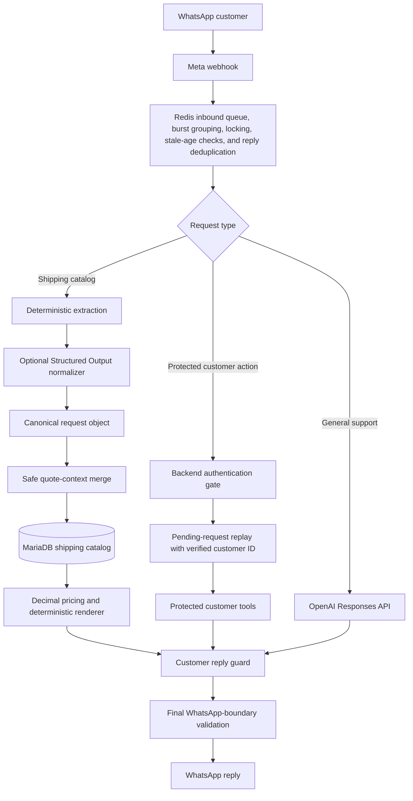

# WhatsApp Shipping & Support Chatbot

A production-oriented Python service for multilingual WhatsApp customer support, authoritative shipping-catalog lookups, protected order assistance, and support-staff administration.

The chatbot accepts English, French, Arabic, Lebanese Arabic, Lebanese Arabizi, Arabizi, and natural mixtures of those styles. Shipping facts and totals come from MariaDB; the AI layer may help normalize customer wording, but it does not receive database credentials, write SQL, choose prices, or perform rate arithmetic.

> **About this README**
> This document describes the latest cumulative build. Historical replacement-bundle and incremental-patch instructions have been intentionally removed so the repository presents one current deployment and operating guide.

## Contents

- [Highlights](#highlights)
- [Architecture](#architecture)
- [Shipping-catalog pipeline](#shipping-catalog-pipeline)
- [Authentication and protected requests](#authentication-and-protected-requests)
- [Customer reply safety](#customer-reply-safety)
- [Staff management](#staff-management)
- [Requirements](#requirements)
- [Configuration](#configuration)
- [Database setup](#database-setup)
- [Validation](#validation)
- [Deployment](#deployment)
- [Acceptance tests](#acceptance-tests)
- [API reference](#api-reference)
- [Operations and troubleshooting](#operations-and-troubleshooting)
- [Key files](#key-files)
- [Security notes](#security-notes)

## Highlights

| Area | Behavior |
| --- | --- |
| Reliable WhatsApp delivery | A durable per-customer/per-business-number Redis queue accepts concurrent inbound messages without `503`, groups rapid message bursts into one turn, preserves unique late deliveries, and keeps at-most-once outbound reply reservation. |
| Public shipping assistance | Guests can request prices, transit times, and route categories without authenticating. |
| Canonical catalog lookup | Multilingual customer wording is converted into explicit English lookup fields before live validation against `shipping_db.destinations` and `shipping_db.shipping_rates`. |
| Deterministic pricing | Only explicit `/kg` rates are multiplied, using backend `Decimal` arithmetic and deterministic currency rounding. |
| Safe conversational context | Current-turn values always override prior quote context; omitted quote fields may be reused only from fresh backend state. |
| Style-preserving responses | Replies remain in the customer’s established language and script, including Latin-only Lebanese Arabizi when that style is active. |
| Protected order assistance | The backend pauses a protected request for credentials, verifies them, and resumes the original action instead of stopping at a login confirmation. |
| Output firewall | Intermediate model commentary, internal notes, prompt/tool leakage, invalid script, control characters, empty replies, and oversized replies are blocked before WhatsApp delivery. |
| Staff lifecycle management | Authorized support staff can list, create, edit, deactivate, reactivate, and safely delete agent/admin accounts from `/support`. |
| Human-support media | Active support tickets can receive and display WhatsApp images/voice notes; the currently assigned staff member can send image captions and browser-recorded voice notes from `/support`. |
| Multi-number support | Each ticket records Meta's receiving `phone_number_id` and display number, shows the receiving line in `/support`, and routes replies/media back through that same WhatsApp business number. |
| Ticket transfer/escalation | The current assignee can transfer an active ticket to another active staff member. Previous assignees remain able to watch the live conversation but become read-only until ownership returns to them. |

## Architecture



Redis stores conversation state, quote context, processing locks, authentication progress, and outbound deduplication data. Conversation/queue keys include the receiving Meta phone-number ID when available, so the same customer can contact different business numbers without mixing context. MariaDB remains the authority for routes, rate rows, staff accounts, support tickets, receiving-number metadata, assignments, and transfer audit events. Human-support images and audio are downloaded from Meta into protected local media storage and are served only through authenticated support routes.

## Shipping-catalog pipeline

Every request related to the shipping catalog follows one backend-owned path.

```text
Customer message
    -> deterministic extraction
    -> optional semantic normalization
    -> canonical request object
    -> safe context merge
    -> live MariaDB validation
    -> Decimal rate calculation
    -> deterministic style-aware response
```

### Supported request kinds

- `price_quote`
- `route_options`
- `transit_time`

A canonical request can contain:

```json
{
  "request_kind": "price_quote",
  "origin": "USA",
  "destination": "Lebanon",
  "goods_type": "Electronics",
  "shipping_method": null,
  "weight_kg": 25,
  "explicit_origin": true,
  "explicit_destination": false,
  "explicit_goods_type": true
}
```

The normalizer returns only fields explicitly stated in the active customer message. It cannot copy old quote values into explicit fields.

### Trust order

1. Exact deterministic extraction from the current customer turn.
2. Structured semantic normalization for unresolved current-turn fields.
3. Fresh backend quote context for omitted price-quote fields only.
4. Live database rows.

This ordering prevents an older route from being reused when the customer explicitly names a new, unsupported destination. It also prevents a model-normalized value from overriding a locally recognized country, category, method, number, or unit.

### Catalog and arithmetic rules

- The database may keep canonical English labels while customers use supported multilingual variants.
- Composite rows such as `Makeup & Electronics` or `Clothes & Accessories` can match any supported component term or transliteration.
- A shipping method is used as a filter only when the active customer message explicitly requests it.
- `/kg` values are parsed and multiplied in backend code.
- Non-`/kg` rows and special-price text are returned as catalog facts; the application does not invent a total.
- Unsupported explicit destinations remain explicit and produce an authoritative no-match response rather than an old quote.
- Quote state expires after the configured TTL so unrelated future numbers are not captured as stale weights.
- If semantic normalization fails or times out, deterministic matching remains available.

> **Catalog scope:** Route-category results describe rows available in the rate catalog. They are not a complete customs, restricted-goods, dangerous-goods, battery, liquid, or import-policy decision.

## Authentication and protected requests

Shipping rates and route options are public. Customer order and shipment operations are protected.

For a protected request, the backend:

1. Saves the original non-secret customer request.
2. Requests the customer’s user ID using a deterministic template in the active language style.
3. Requests the password without adding it to conversation JSON or sending it to OpenAI.
4. Verifies the credentials in backend code.
5. Replays the exact blocked protected operation with the verified `users.id` injected by the backend.
6. Returns the requested order or shipment result immediately instead of stopping at a login-only acknowledgement.

Example Lebanese Arabizi flow:

```text
Customer: bade tshefle order
Bot:      B3atle l user ID taba3ak.
Customer: 10002
Bot:      Tamem, b3atle l password la nkammel.
Customer: ********
Bot:      [returns the authenticated customer's order/shipment result]
```

When the blocked action is a recent-order lookup, the backend can render the authoritative list directly, including available order IDs, tracking numbers, shipment IDs, and statuses.

Authentication is interruptible. While credentials are pending, explicit cancellation phrases such as `cancel`, `Abort`, `never mind`, and supported Lebanese/Arabic/French equivalents clear the pending user ID, one-time password, protected request, and replay tool state. A high-confidence new shipping/support/question intent also abandons the stale login before normal request handling, so a customer can change subject without having an unrelated message interpreted as a password. Explicit credential labels and fresh login intent still take precedence.

## Customer reply safety

The final customer message is treated as a security boundary, not merely as model text.

### Phase-aware extraction

- `phase="final_answer"` output is preferred.
- `phase="commentary"` output is discarded.
- Unphased output remains supported for compatible model/SDK responses.
- A commentary-only response is treated as empty, never as customer-ready text.

### Deterministic reply guard

Before persistence or delivery, the application rejects replies containing:

- known drafting or self-correction phrases;
- prompt, tool, or internal-state leakage markers;
- Arabic-script letters while `leb_arabizi` is active;
- control characters;
- empty or oversized content.

A failed reply receives one isolated, no-tools repair attempt using strict structured output. The repaired text is validated again. If it still fails, the unsafe text is neither stored nor sent; a deterministic style-safe fallback is used. A second validation runs immediately before the WhatsApp send path.

## Staff management

Authenticated `supervisor` and `admin` users can manage staff accounts from `/support`.

Supported actions include:

- list active and inactive accounts;
- create `agent` or `admin` accounts;
- change a name or email/login credential;
- reset a password;
- change `agent` ↔ `admin` role;
- deactivate or reactivate an account;
- safely delete an account by deactivating it and revoking its sessions.

Safety rules include:

- agents cannot access staff-management endpoints;
- write operations require the existing authenticated support session and CSRF token;
- initial passwords must be at least 12 characters and no more than 72 UTF-8 bytes;
- passwords are bcrypt-hashed with cost 12 outside the event loop;
- changing email, password, role, or activation state revokes the target account’s active sessions;
- a user cannot deactivate, delete, or change the role of their own active session account;
- bootstrap `supervisor` accounts cannot be structurally changed through the web screen;
- normalized email identity is trimmed and case-insensitive;
- duplicate normalized emails return HTTP `409` and direct the operator to edit the existing account.

Safe deletion preserves staff IDs referenced by support history and audit data.

### Images and voice notes in human support

While a durable support ticket is active, inbound WhatsApp `image` and `audio` messages are downloaded from Meta and attached to the ticket timeline instead of being stored as unsupported placeholders. The support dashboard renders images inline and provides native audio playback controls.

The currently assigned staff member can also:

- select a JPEG or PNG image, preview it, add an optional caption, and send it to the customer;
- record a voice note from the browser microphone, stop and preview it, remove it if necessary, then send it;
- open received/sent images at full size;
- play received/sent audio without exposing the underlying Meta media URL.

Browser microphone formats vary. The backend converts browser recordings to Ogg/Opus with `ffmpeg` before uploading them to WhatsApp. Media files are stored under `SUPPORT_MEDIA_DIRECTORY`, outside the public web root and, by default, outside the project tree watched by `uvicorn --reload`. They are retrieved through authenticated `/api/support/.../media` routes.

### Agent privacy and ticket confidentiality

Regular support agents now have participation-scoped ticket visibility. A ticket is considered part of an agent's work history when the agent claimed it, was assigned to it through a transfer, or remains its current assignee.

For regular agents:

- **History** only contains resolved/closed tickets that agent actually worked on;
- **Active** and **Waiting** only contain active tickets that agent is currently handling or previously handled;
- direct requests for an unrelated ticket ID return `403` before conversation messages or events are loaded;
- image and voice-note media endpoints apply the same ticket-participation authorization;
- a previous assignee who transferred a ticket away keeps the intended read-only **Watching** access because they are a legitimate participant;
- unassigned `NEW` tickets remain visible so agents can inspect and claim incoming work.

Supervisors and administrators retain unrestricted ticket visibility and management access.

As shared-workstation hardening, support pages/API/media responses are marked `Cache-Control: no-store`, dashboard API fetches bypass the browser cache, and logging out clears the open ticket, conversation, context, queue, draft, and composer state before another staff account can sign in.

This privacy update uses the existing claim/transfer audit trail and does not require an additional database migration.

### Multiple support numbers and ticket transfers

Meta includes the receiving business line in each inbound webhook as `metadata.phone_number_id` and `metadata.display_phone_number`. The service persists both values on the support ticket and displays the receiving line in the queue and ticket detail panel. Outbound text, images, and voice notes use the ticket's stored `business_phone_number_id`, so a customer who contacted support number B is answered from number B rather than from the application's default number A.

Conversation state and inbound processing are also separated by `(business_phone_number_id, customer WhatsApp number)`. This prevents one customer's conversations with two different support numbers from sharing Redis state, locks, or burst queues.

Active assigned tickets can be transferred from the dashboard:

- the selected staff member becomes the new current assignee;
- only the current assignee can send text, images, or voice notes;
- the agent who transferred the ticket sees it in **Watching** and can follow new messages/events live, but the composer is disabled;
- a supervisor can transfer/manage an active ticket, but must make themselves the assignee before replying;
- the new assignee can transfer the ticket back, transfer it onward, or resolve it and return the customer directly to AI;
- transfer events are written to the existing `support_ticket_events` audit timeline;
- ownership is rechecked atomically when sending, so an old browser tab cannot send after a transfer wins the race.

The transfer target list exposes only minimal active-staff identity (`id`, `name`, `role`); credentials and password data are never returned.

## Requirements

The supplied build notes assume the following services already exist:

- a Python application environment and virtual environment;
- MariaDB for application data and the shipping catalog;
- Redis for conversation state, locking, quote context, and idempotency;
- Meta WhatsApp webhook/API credentials;
- an OpenAI API key and configured model;
- `systemd` for the documented production service commands;
- `ffmpeg` available on the application host for browser-recorded voice-note conversion.

The source notes do not declare a minimum Python version or the repository’s dependency installation command. Use the Python version and dependency manifest committed with the project rather than guessing a version here.

Required MariaDB objects include:

```text
shipping_db.destinations
shipping_db.shipping_rates
staff
staff_sessions
```

## Configuration

The following settings are documented by the cumulative build. Defaults are already present in code, but production deployments may set them explicitly in `.env`.

| Variable | Default | Purpose |
| --- | ---: | --- |
| `SHIPPING_DB_SCHEMA` | `shipping_db` | Schema containing destinations and shipping rates. |
| `SHIPPING_SEMANTIC_NORMALIZER_ENABLED` | `true` | Enables optional semantic normalization for unresolved multilingual fields. |
| `SHIPPING_SEMANTIC_NORMALIZER_MODEL` | blank | Uses `OPENAI_MODEL` when blank. |
| `SHIPPING_SEMANTIC_NORMALIZER_TIMEOUT_SECONDS` | `10` | Bounds the semantic normalizer before deterministic fallback. |
| `SHIPPING_CATALOG_CACHE_SECONDS` | `60` | Briefly caches the small destination/rate catalog. |
| `SHIPPING_QUOTE_CONTEXT_TTL_SECONDS` | `1800` | Expires incomplete and recent quote context after 30 minutes. |
| `OPENAI_REQUEST_TIMEOUT_SECONDS` | `45` | Provider request timeout. |
| `OPENAI_MAX_RETRIES` | `1` | Maximum provider retry count. |
| `OPENAI_TURN_TIMEOUT_SECONDS` | `90` | Hard deadline for the complete AI turn. |
| `WHATSAPP_MAX_INBOUND_AGE_SECONDS` | `900` | Rejects uniquely delivered inbound messages older than 15 minutes; `0` accepts any age. |
| `WHATSAPP_MESSAGE_BURST_DEBOUNCE_SECONDS` | `1.25` | Quiet period used to collect adjacent customer messages into one conversational turn. |
| `WHATSAPP_MESSAGE_BURST_MAX_WAIT_SECONDS` | `4.0` | Maximum time the burst collector may wait while new messages keep arriving. |
| `WHATSAPP_MESSAGE_BURST_MAX_MESSAGES` | `8` | Maximum adjacent text messages combined into one AI turn; overflow remains queued for the next turn. |
| `CONVERSATION_PROCESSING_LOCK_TTL_SECONDS` | `180` | Redis lock lifetime for per-sender processing. |
| `OUTBOUND_REPLY_DEDUPE_TTL_SECONDS` | `604800` | Keeps outbound reply reservations for seven days. |
| `SUPPORT_MEDIA_DIRECTORY` | `~/.local/share/whatsapp_chatbot/support_media` | Protected local storage for support-ticket images and audio, outside the source tree watched by `uvicorn --reload`. |
| `SUPPORT_IMAGE_MAX_BYTES` | `5242880` | Maximum image size accepted by the support media pipeline. |
| `SUPPORT_AUDIO_MAX_BYTES` | `16777216` | Maximum voice/audio size accepted by the support media pipeline. |
| `SUPPORT_MEDIA_DOWNLOAD_TIMEOUT_SECONDS` | `20` | Timeout for Meta media metadata/download and upload operations. |
| `SUPPORT_MEDIA_TRANSCODE_TIMEOUT_SECONDS` | `30` | Maximum time allowed to convert a browser recording to Ogg/Opus. |
| `SUPPORT_MEDIA_FFMPEG_PATH` | `ffmpeg` | ffmpeg executable used for voice-note conversion. |

The deployment must also retain its existing OpenAI, Redis, MariaDB, and WhatsApp/Meta credentials. The supplied notes identify `OPENAI_API_KEY`, `OPENAI_MODEL`, and `REDIS_URL`, but do not define every database or Meta credential variable name; preserve the names already used by `app/config.py` and the service environment.

To disable semantic normalization while keeping deterministic aliases, context safety, database matching, arithmetic, and rendering:

```dotenv
SHIPPING_SEMANTIC_NORMALIZER_ENABLED=false
```

## Database setup

### Support ticket channel metadata

Apply the included support-ticket migration **before restarting the updated application code**:

```bash
mysql -u <db-user> -p <database-name> < migrations/20260829_support_ticket_channels_and_transfers.sql
```

The migration adds two nullable fields to `support_tickets` plus an index:

```text
business_phone_number_id
business_display_phone_number
```

Transfer history does not need a new table; it uses the existing `support_ticket_events` table. Existing active tickets created before this migration are backward-compatible: when the next inbound webhook provides Meta receiving-number metadata, the service binds that legacy active ticket to the receiving channel.

### Shipping-catalog permissions

The application’s MariaDB account needs read access to both catalog tables. Use the actual account host returned by MariaDB.

```sql
SELECT User, Host
FROM mysql.user
WHERE User = 'whatsapp_bot';
```

Then grant access to the matching account:

```sql
GRANT SELECT ON shipping_db.destinations
TO 'whatsapp_bot'@'<application-host>';

GRANT SELECT ON shipping_db.shipping_rates
TO 'whatsapp_bot'@'<application-host>';

FLUSH PRIVILEGES;
```

A direct catalog check should use the same host, port, username, and password as the running service. Access through an administrative UI does not prove that the application account has permission.

### Staff email uniqueness

Deploy the application code first, then run:

```bash
source venv/bin/activate
python ensure_staff_email_uniqueness.py
```

When the table is clean, the script backfills `email_normalized` and ensures this invariant:

```sql
UNIQUE KEY uq_staff_email_normalized (email_normalized)
```

If duplicate rows already exist, the script stops without changing the table and prints their IDs. Resolve those records in `/support`, then run the script again. It intentionally does not hard-delete staff rows because historical records may reference their IDs.

A reference migration is included at:

```text
migrations/20260826_staff_email_uniqueness.sql
```

The Python migration helper is preferred because it applies the same normalization rules as the application and checks for the exact single-column unique index.

## Validation

From the repository root:

```bash
source venv/bin/activate
ffmpeg -version | head -n 1
python -m compileall -q app
pytest -q
```

Verify the live MariaDB catalog without making an OpenAI request:

```bash
python verify_canonical_shipping_pipeline.py
```

Expected output:

```text
OK: canonical English shipping fields, live catalogue lookup, Decimal pricing, context replacement, and style-safe rendering are ready.
```

An optional semantic-normalizer smoke test makes one OpenAI request:

```bash
python verify_canonical_shipping_pipeline.py --semantic-smoke
```

Run the staff email migration/check as part of deployment validation when the schema invariant has not already been installed:

```bash
python ensure_staff_email_uniqueness.py
```

Local compilation and tests do not replace a live WhatsApp and MariaDB acceptance test in the target environment.

## Deployment

The documented VPS layout uses `/root/whatsapp_chatbot_latest`, an existing `venv`, and a `systemd` unit named `shipment-bot`. Adapt these paths and names when your deployment differs.

```bash
cd /root/whatsapp_chatbot_latest

# Preserve the currently deployed application package.
cp -a app "app.backup.$(date +%Y%m%d-%H%M%S)"

# Update this checkout using your normal Git deployment process.

source venv/bin/activate
pip install -r requirements.txt
ffmpeg -version | head -n 1
python -m compileall -q app
pytest -q
python ensure_staff_email_uniqueness.py
python verify_canonical_shipping_pipeline.py

sudo systemctl restart shipment-bot
sudo journalctl -u shipment-bot -n 200 --no-pager
```

Do not set `REDIS_URL=''` in production. Redis is required for cross-worker and cross-restart locking, state, and idempotency behavior.

## Acceptance tests

Use a clean test conversation when validating quote context or the two-step authentication flow:

```bash
redis-cli DEL "conversation:<CUSTOMER_WHATSAPP_NUMBER>"
```

Use the customer number in the same format supplied by Meta. Delete only the test conversation key; do not flush the production Redis database.

### Public price quote

Send as a logged-out customer:

```text
shu se3er she7nit cosmetics mn uae aa lebnen bl jaw? 20kg
```

Expected behavior:

- no authentication prompt;
- matching live UAE → Lebanon catalog rows;
- exact backend-calculated totals for explicit `/kg` prices;
- Lebanese Arabizi output with no Arabic-script prose;
- both pickup and delivery totals when the customer did not choose one.

### Public route categories

Send:

```text
طيب شو فيني اشحن من اميركا على لبنان
```

Expected behavior:

- no weight or authentication requirement;
- categories, methods/schedules, listed price text, and transit times from live USA → Lebanon rows;
- no unsupported claim that information is unavailable when rows exist;
- a clear scope note when customs or restricted-goods details require separate confirmation.

### Context-safe multilingual sequence

Send the following in one clean conversation:

```text
eza bade esh7an mawed tejmil mn el emarat 3a lebnen adesh betkallef
25
tyb eza bade esh7an mn el su3udiye 3a lebnen
tamem ysallemon
electronics adesh?
electronics men amerka
ekseswar 3a souriya
50kg ekseswar 3a souriya
tyb 3al iraq fine esh7an?
```

Verify that:

- UAE and KSA totals use their matching `/kg` rows;
- a conversational acknowledgement is not treated as a quote continuation;
- a missing KSA electronics rate returns available categories instead of an invented price;
- `electronics men amerka` selects USA electronics and preserves Lebanese Arabizi;
- `ekseswar` maps to `Clothes & Accessories`;
- `50kg` recalculates the same authoritative row;
- explicit Iraq replaces the old route and returns an authoritative unsupported-destination result;
- the Iraq answer contains no amount or route from the prior quote.

### Authentication resume

Send:

```text
bade tshefle order
```

Complete the user-ID and password flow. The first response after successful authentication must contain the requested order/shipment result. It must not stop at only a login confirmation, and no password may appear in stored conversation data or model input.

### Human-support media

With an active ticket claimed by a test agent:

1. Send an image from the customer WhatsApp account; verify it appears inline in `/support` rather than as an unsupported-message placeholder.
2. Send a WhatsApp voice note; verify the agent can play it in the ticket timeline.
3. From `/support`, select an image, optionally add a caption, and send it; verify the customer receives the image and caption.
4. Record a browser voice note, stop it, preview it, and send it; verify the customer receives playable audio.
5. While audio is playing in the dashboard, verify background queue polling does not interrupt playback.

### Multiple support numbers and transfers

With at least two Meta WhatsApp business phone numbers subscribed to the webhook:

1. Send a customer message to support number A and verify the ticket shows number A under **Received on**.
2. Send a separate message from the same customer to support number B and verify it remains a separate conversation/ticket context for number B.
3. Reply to each ticket and verify the customer receives the reply from the same number they originally contacted.
4. Claim a ticket as Agent A, transfer it to Agent B, and verify Agent A sees it under **Watching** with a disabled composer.
5. Verify Agent B sees the ticket as assigned and can send text, image, and voice-note replies.
6. Keep Agent A's old ticket tab open and attempt a stale send after transfer; verify the backend rejects it.
7. Transfer the ticket back to Agent A and verify it returns to Agent A's normal assigned workflow.
8. Alternatively, resolve it as Agent B and verify the ticket leaves the active/watching queues and the conversation returns to AI.

### Staff lifecycle

As a supervisor or administrator:

1. Create a test agent.
2. Edit its name and email.
3. Reset its password.
4. Change its role and verify the old session is revoked.
5. Deactivate it and verify login fails.
6. Reactivate it.
7. Delete it and confirm it remains inactive with sessions revoked.
8. Attempt to create another account using the same email with different casing or whitespace; expect HTTP `409` and an edit-existing-account path.
9. Sign in as an agent and verify the UI control is hidden and direct staff API calls return HTTP `403`.

## API reference

Staff management is exposed under the existing support application.

| Method | Endpoint | Purpose | Authorization |
| --- | --- | --- | --- |
| `GET` | `/api/support/staff` | List active and inactive staff accounts using a safe public projection. | `supervisor` or `admin` |
| `POST` | `/api/support/staff` | Create an `agent` or `admin`. | `supervisor` or `admin`, authenticated session, CSRF |
| `PATCH` | `/api/support/staff/{staff_id}` | Update identity, credentials, role, or activation state. | `supervisor` or `admin`, authenticated session, CSRF |
| `DELETE` | `/api/support/staff/{staff_id}` | Safely deactivate the account and revoke sessions. | `supervisor` or `admin`, authenticated session, CSRF |
| `GET` | `/api/support/tickets?view=watching` | List active tickets the signed-in staff member previously transferred away and may continue observing. | Authenticated support staff |
| `GET` | `/api/support/transfer-targets` | Return a minimal list of active staff eligible for assignment. | Authenticated support staff |
| `POST` | `/api/support/tickets/{ticket_id}/transfer` | Atomically transfer an active assigned ticket to another active staff member. | Current assignee or supervisor, authenticated session, CSRF |
| `POST` | `/api/support/tickets/{ticket_id}/messages` | Send a text reply using the ticket's receiving WhatsApp business number. | Current assignee only, authenticated session, CSRF |
| `POST` | `/api/support/tickets/{ticket_id}/media` | Send an image or voice note using the ticket's receiving WhatsApp business number. | Current assignee only, authenticated session, CSRF |
| `GET` | `/api/support/tickets/{ticket_id}/messages/{message_id}/media` | Stream protected ticket media for inline image/audio rendering. | Authenticated support staff |

Example create body:

```json
{
  "name": "Agent Name",
  "email": "agent@example.com",
  "password": "minimum-12-characters",
  "role": "agent"
}
```

`role` is restricted to `agent` or `admin`. Creating another bootstrap `supervisor` through the web interface is intentionally unsupported.

Shipping-price and route-option operations are customer-facing chatbot capabilities rather than documented public HTTP endpoints in the supplied materials.

## Operations and troubleshooting

### Useful log messages

| Log text | Meaning |
| --- | --- |
| `Shipping catalogue request normalized: kind=price_quote ...` | A canonical price request reached the shipping pipeline. |
| `Shipping catalogue request normalized: kind=route_options ...` | A route-category request reached the shipping pipeline. |
| `Shipping semantic normalizer unavailable: error_type=...` | Semantic normalization failed or timed out; deterministic parsing remains available. |
| `Outbound reply suppressed by idempotency guard` | A duplicate outbound reply was blocked. |
| `Stale inbound WhatsApp message ignored` | A true duplicate/expired inbound message was acknowledged without processing; a unique late timestamp is still processed. |
| `Inbound WhatsApp message queued behind active turn` | Another message for the same customer arrived while a turn was running; it was accepted into Redis instead of returning `503`. |
| `Processing WhatsApp message burst` | Two or more rapid text messages were combined into one customer turn so later details are available before the reply is generated. |
| `WhatsApp media uploaded: media_id=...` | A staff image/voice attachment was accepted by Meta's media endpoint before message send. |
| `Inbound WhatsApp media capture will be retried` | Meta media retrieval had a transient failure; the original claimed webhook item remains queued for retry. |
| `AI turn timed out` | The complete AI turn exceeded its deadline. |
| `Authentication gate activated: ... pending_request=True ...` | A protected request was preserved while credentials were requested. |
| `AI tool dispatch: tool=get_customer_shipments authenticated=True` | A protected shipment action ran after authentication. |
| `Pending request resume produced no protected tool call; retrying` | A login-only response was rejected and the original request was retried. |
| `AI customer reply rejected by output guard` | Unsafe or malformed model output was blocked. |
| `AI customer reply repaired by output guard` | The isolated formatter produced a valid replacement. |
| `Unsafe AI reply blocked at WhatsApp boundary` | The final send-boundary check prevented delivery. |

### Common checks

**A route exists in phpMyAdmin but the bot cannot find it**

Test with the exact MariaDB account and connection settings used by the service, then verify `SELECT` grants on both shipping catalog tables.

**A quote appears to reuse old context**

Delete only the affected test conversation’s Redis key and repeat the full sequence. Confirm that explicit current-turn fields are present in normalization logs.

**Staff creation reports a duplicate email**

Edit the existing account rather than creating another role-specific duplicate. Run `python ensure_staff_email_uniqueness.py` after resolving legacy conflicts.

**Semantic normalization is unavailable**

Check the OpenAI configuration and timeout. The deterministic matcher should continue to handle recognized aliases, digits, units, context safety, database validation, arithmetic, and rendering.

**Rapid customer messages produce a busy response**

They should not. Unique inbound messages are accepted into the per-sender Redis queue while another turn is active. If `503 conversation_busy` reappears, verify that the updated queue build is actually running and that Redis is available.

**Voice recording says ffmpeg is required**

Install `ffmpeg` on the application host or set `SUPPORT_MEDIA_FFMPEG_PATH` to the executable. Received WhatsApp voice notes do not require transcoding; this dependency is for browser microphone recordings that arrive as WebM/MP4 and must be normalized before WhatsApp upload.

## Key files

| Path | Responsibility |
| --- | --- |
| `app/main.py` | Webhook orchestration, authentication flow, send-boundary checks, and application entry behavior. |
| `app/config.py` | Service and shipping-pipeline configuration. |
| `app/ai_config.py` | Model instructions and tool behavior. |
| `app/openai_service.py` | Responses API calls, phase-aware extraction, tool flow, and guarded reply handling. |
| `app/conversation_store.py` | Redis-backed conversation, quote, authentication, and processing state. |
| `app/language.py` | Language/style detection and Lebanese Arabizi handling. |
| `app/shipping_intent_normalizer.py` | Narrow Structured Output normalization of explicit shipping fields. |
| `app/shipping_quote_service.py` | Canonical request handling, context merge, pricing, and deterministic rendering. |
| `app/shipment_client.py` | Live shipping-catalog and customer shipment access. |
| `app/customer_reply_guard.py` | Deterministic validation of customer-visible replies. |
| `app/whatsapp_client.py` | WhatsApp text/media delivery, media upload/download, and inbound media metadata parsing. |
| `app/support_media.py` | Protected support-media storage, MIME/size validation, and browser voice-note conversion. |
| `app/staff_management.py` | Staff-account lifecycle rules. |
| `app/staff_repository.py` | Staff persistence and normalized email checks. |
| `app/support_api.py` | Support and staff-management API routes. |
| `app/support_ui.py` | `/support` dashboard behavior. |
| `tests/test_canonical_shipping_pipeline.py` | Canonical shipping-pipeline coverage. |
| `migrations/20260826_staff_email_uniqueness.sql` | Reference unique-email migration. |
| `migrations/20260829_support_ticket_channels_and_transfers.sql` | Adds receiving WhatsApp business-number metadata/indexes used by multi-number ticket routing. |
| `ensure_staff_email_uniqueness.py` | Preferred staff email backfill and invariant installer. |
| `verify_canonical_shipping_pipeline.py` | Live catalog verifier and optional semantic smoke test. |

## Security notes

- Database credentials are not provided to the model.
- The model does not write SQL, select rates, or calculate shipping totals.
- Passwords stay outside conversation JSON and are never sent to OpenAI.
- Protected tools receive the verified customer ID from backend code, not from model-provided identity.
- Redis locks and outbound reservations enforce ordering and at-most-once primary replies across workers and restarts.
- Customer output is validated before persistence and again before WhatsApp delivery.
- Rejected reply bodies are not written to application logs; reply-guard logs contain reason labels and hashed customer identifiers.
- Canonical shipping logs record operation type and field-presence information rather than raw customer messages or provider response bodies.
- Staff passwords and hashes are not returned by the API or written to logs.
- Credential, role, and activation changes revoke active sessions.
- Safe staff deletion preserves historical references by deactivating the account instead of hard-deleting its row.
- Support images and audio are stored outside the public web root and require an authenticated support session to retrieve.
- Meta media URLs are never exposed directly to browser JavaScript; the backend downloads media with the WhatsApp token and serves only the validated local copy.

## AI abuse and OpenAI cost protection

Customer-triggered AI work is protected by rolling quotas before an OpenAI-backed path is allowed to run. The limiter uses Redis when `REDIS_URL` is configured, so the same limits apply across Uvicorn workers/processes instead of resetting per process.

Default policy:

```dotenv
AI_RATE_LIMIT_ENABLED=true
AI_RATE_LIMIT_TURNS_PER_MINUTE=6
AI_RATE_LIMIT_TURNS_PER_HOUR=30
AI_RATE_LIMIT_TURNS_PER_DAY=120
AI_RATE_LIMIT_GLOBAL_TURNS_PER_DAY=2000
AI_RATE_LIMIT_NOTICE_COOLDOWN_SECONDS=60
AI_RATE_LIMIT_FAIL_CLOSED=true
OPENAI_MAX_OUTPUT_TOKENS=1400
```

A turn is consumed only when a customer actually needs an AI-backed path. Rapid WhatsApp messages that were combined by the message-burst queue count as one turn. Human-owned support tickets do not consume this quota, and a shipping question that can be answered completely by deterministic parsing plus the MariaDB catalogue is allowed without consuming an AI turn. The optional semantic shipping normalizer is enabled only after the same AI quota check passes.

Per-customer limits are keyed by the customer's WhatsApp sender number across all of the business's receiving numbers, so contacting a second company number does not reset the quota. `AI_RATE_LIMIT_GLOBAL_TURNS_PER_DAY` is a deployment-wide circuit breaker intended to contain distributed abuse from many different sender numbers. Set a limit to `0` to disable only that window.

When a quota is exceeded, the service does **not** call OpenAI and does **not** return a retryable webhook `429`. Meta receives a successful webhook response, while the customer receives a deterministic language/style-aware slowdown message. Repeated blocked messages are silently absorbed during `AI_RATE_LIMIT_NOTICE_COOLDOWN_SECONDS` so an attacker cannot turn the protection itself into an outbound-message flood.

With `AI_RATE_LIMIT_FAIL_CLOSED=true`, a failure to verify Redis quota blocks AI usage rather than risking unmetered OpenAI calls. `OPENAI_MAX_OUTPUT_TOKENS` adds a second cost boundary for allowed generative turns; the shipping normalizer and reply-repair paths retain their own narrower structured-output caps.

The defaults are conservative starting points rather than a monetary spending guarantee. Tune the minute/hour/day/global quotas to your normal ticket volume and acceptable AI budget.
