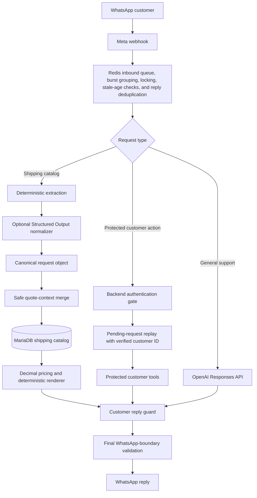

# WhatsApp Shipping & Support Chatbot

A production-oriented Python service for multilingual WhatsApp customer support, authoritative shipping-catalog lookups, protected order assistance, and support-staff administration.

The chatbot accepts English, French, Arabic, Lebanese Arabic, Lebanese Arabizi, Arabizi, and natural mixtures of those styles. Shipping facts and totals come from MariaDB; the AI layer may help normalize customer wording, but it does not receive database credentials, write SQL, choose prices, or perform rate arithmetic.

> **About this README**
> This document describes the latest cumulative build. Historical replacement-bundle and incremental-patch instructions have been intentionally removed so the repository presents one current deployment and operating guide.

## Contents

- [Highlights](#highlights)
- [Architecture](#architecture)
- [Shipping-catalog pipeline](#shipping-catalog-pipeline)
- [Authentication and protected requests](#authentication-and-protected-requests)
- [Customer reply safety](#customer-reply-safety)
- [Staff management](#staff-management)
- [Requirements](#requirements)
- [Configuration](#configuration)
- [Database setup](#database-setup)
- [Validation](#validation)
- [Deployment](#deployment)
- [Acceptance tests](#acceptance-tests)
- [API reference](#api-reference)
- [Operations and troubleshooting](#operations-and-troubleshooting)
- [Key files](#key-files)
- [Security notes](#security-notes)

## Highlights

| Area | Behavior |
| --- | --- |
| Reliable WhatsApp delivery | A durable per-customer/per-business-number Redis queue accepts concurrent inbound messages without `503`, groups rapid message bursts into one turn, preserves unique late deliveries, and keeps at-most-once outbound reply reservation. |
| Public shipping assistance | Guests can request prices, transit times, and route categories without authenticating. |
| Canonical catalog lookup | Multilingual customer wording is converted into explicit English lookup fields before live validation against `shipping_db.destinations` and `shipping_db.shipping_rates`. |
| Deterministic pricing | Only explicit `/kg` rates are multiplied, using backend `Decimal` arithmetic and deterministic currency rounding. |
| Safe conversational context | Current-turn values always override prior quote context; omitted quote fields may be reused only from fresh backend state. |
| Style-preserving responses | Replies remain in the customer’s established language and script, including Latin-only Lebanese Arabizi when that style is active. |
| Protected order assistance | The backend pauses a protected request for credentials, verifies them, and resumes the original action instead of stopping at a login confirmation. |
| Output firewall | Intermediate model commentary, internal notes, prompt/tool leakage, invalid script, control characters, empty replies, and oversized replies are blocked before WhatsApp delivery. |
| Staff lifecycle management | Authorized support staff can list, create, edit, deactivate, reactivate, and safely delete agent/admin accounts from `/support`. |
| WhatsApp-style support messaging | Active support tickets support images, videos, audio/voice notes, customer locations, PDF documents, and message-level reply context. Staff can play videos in the timeline, copy images to the clipboard, edit images (draw, text, crop, rotate) before or after sending, zoom/pan, and manage messages in the support timeline. |
| Agent notifications | The dashboard watches the Unassigned queue independently, updates its count while staff work elsewhere, and plays an audible/in-app notification for new unassigned work or new customer activity. |
| Multi-number support | Each ticket records its receiving business-line ID and display number, shows the receiving line in `/support`, and routes replies/media back through that same WhatsApp number. |
| Ticket transfer/escalation | The current assignee can transfer an active ticket to another active staff member. Previous assignees remain able to watch the live conversation but become read-only until ownership returns to them. |

## Architecture



Redis stores conversation state, quote context, processing locks, authentication progress, and outbound deduplication data. Conversation/queue keys include the receiving business-line ID when available, so the same customer can contact different business numbers without mixing active conversations. MariaDB remains the authority for routes, rate rows, staff accounts, support tickets, receiving-number metadata, assignments, transfer audit events, reply context, and customer-shared location metadata. Human-support images, audio, and PDF documents are cached in protected local media storage and are served only through authenticated support routes.

## Shipping-catalog pipeline

Every request related to the shipping catalog follows one backend-owned path.

```text
Customer message
    -> deterministic extraction
    -> optional semantic normalization
    -> canonical request object
    -> safe context merge
    -> live MariaDB validation
    -> Decimal rate calculation
    -> deterministic style-aware response
```

### Supported request kinds

- `price_quote`
- `route_options`
- `transit_time`

A canonical request can contain:

```json
{
  "request_kind": "price_quote",
  "origin": "USA",
  "destination": "Lebanon",
  "goods_type": "Electronics",
  "shipping_method": null,
  "weight_kg": 25,
  "explicit_origin": true,
  "explicit_destination": false,
  "explicit_goods_type": true
}
```

The normalizer returns only fields explicitly stated in the active customer message. It cannot copy old quote values into explicit fields.

### Trust order

1. Exact deterministic extraction from the current customer turn.
2. Structured semantic normalization for unresolved current-turn fields.
3. Fresh backend quote context for omitted price-quote fields only.
4. Live database rows.

This ordering prevents an older route from being reused when the customer explicitly names a new, unsupported destination. It also prevents a model-normalized value from overriding a locally recognized country, category, method, number, or unit.

### Catalog and arithmetic rules

- The database may keep canonical English labels while customers use supported multilingual variants.
- Composite rows such as `Makeup & Electronics` or `Clothes & Accessories` can match any supported component term or transliteration.
- A shipping method is used as a filter only when the active customer message explicitly requests it.
- `/kg` values are parsed and multiplied in backend code.
- Non-`/kg` rows and special-price text are returned as catalog facts; the application does not invent a total.
- Unsupported explicit destinations remain explicit and produce an authoritative no-match response rather than an old quote.
- Quote state expires after the configured TTL so unrelated future numbers are not captured as stale weights.
- If semantic normalization fails or times out, deterministic matching remains available.

> **Catalog scope:** Route-category results describe rows available in the rate catalog. They are not a complete customs, restricted-goods, dangerous-goods, battery, liquid, or import-policy decision.

## Authentication and protected requests

Shipping rates and route options are public. Customer order and shipment operations are protected.

For a protected request, the backend:

1. Saves the original non-secret customer request.
2. Requests the customer’s user ID using a deterministic template in the active language style.
3. Requests the password without adding it to conversation JSON or sending it to OpenAI.
4. Verifies the credentials in backend code.
5. Replays the exact blocked protected operation with the verified `users.id` injected by the backend.
6. Returns the requested order or shipment result immediately instead of stopping at a login-only acknowledgement.

Example Lebanese Arabizi flow:

```text
Customer: bade tshefle order
Bot:      B3atle l user ID taba3ak.
Customer: 10002
Bot:      Tamem, b3atle l password la nkammel.
Customer: ********
Bot:      [returns the authenticated customer's order/shipment result]
```

When the blocked action is a recent-order lookup, the backend can render the authoritative list directly, including available order IDs, tracking numbers, shipment IDs, and statuses.

Authentication is interruptible. While credentials are pending, explicit cancellation phrases such as `cancel`, `Abort`, `never mind`, and supported Lebanese/Arabic/French equivalents clear the pending user ID, one-time password, protected request, and replay tool state. A high-confidence new shipping/support/question intent also abandons the stale login before normal request handling, so a customer can change subject without having an unrelated message interpreted as a password. Explicit credential labels and fresh login intent still take precedence.

## Customer reply safety

The final customer message is treated as a security boundary, not merely as model text.

### Phase-aware extraction

- `phase="final_answer"` output is preferred.
- `phase="commentary"` output is discarded.
- Unphased output remains supported for compatible model/SDK responses.
- A commentary-only response is treated as empty, never as customer-ready text.

### Deterministic reply guard

Before persistence or delivery, the application rejects replies containing:

- known drafting or self-correction phrases;
- prompt, tool, or internal-state leakage markers;
- Arabic-script letters while `leb_arabizi` is active;
- control characters;
- empty or oversized content.

A failed reply receives one isolated, no-tools repair attempt using strict structured output. The repaired text is validated again. If it still fails, the unsafe text is neither stored nor sent; a deterministic style-safe fallback is used. A second validation runs immediately before the WhatsApp send path.

## Staff management

Authenticated `supervisor` and `admin` users can manage staff accounts from `/support`.

Supported actions include:

- list active and inactive accounts;
- create `agent` or `admin` accounts;
- change a name or email/login credential;
- reset a password;
- change `agent` ↔ `admin` role;
- deactivate or reactivate an account;
- delete an active or deactivated account. Deletion revokes its sessions, removes it from the staff list, blocks sign-in, editing and reactivation, and frees its email for a new account. The row stays in MariaDB (`staff.deleted_at`) so tickets and audit records keep their references. Apply `migrations/20261017_staff_account_deletion.sql` before deploying this behavior.

Safety rules include:

- agents cannot access staff-management endpoints;
- write operations require the existing authenticated support session and CSRF token;
- initial passwords must be at least 12 characters and no more than 72 UTF-8 bytes;
- passwords are bcrypt-hashed with cost 12 outside the event loop;
- changing email, password, role, or activation state revokes the target account’s active sessions;
- a user cannot deactivate, delete, or change the role of their own active session account;
- bootstrap `supervisor` accounts cannot be structurally changed through the web screen;
- normalized email identity is trimmed and case-insensitive;
- duplicate normalized emails return HTTP `409` and direct the operator to edit the existing account.

Safe deletion preserves staff IDs referenced by support history and audit data.

### WhatsApp media, stickers, reactions, locations, documents, and direct replies in human support

While a durable support ticket is active, inbound WhatsApp `image`, `sticker`, `audio`, `document`, and `location` messages are preserved on the ticket timeline rather than being discarded or sent to AI. Images/stickers/audio/PDFs use protected support-media storage; locations retain their latitude/longitude/name/address and render as a map card for the agent. WhatsApp reaction webhooks update metadata on the original message and never create standalone timeline messages.

The currently assigned staff member can also:

- select a JPEG or PNG image, preview it, add an optional caption, and send it to the customer;
- select and send a WebP WhatsApp sticker;
- attach and send a PDF with an optional caption;
- record a voice note from the browser microphone, stop and preview it, remove it if necessary, then send it;
- reply directly to a specific customer or staff WhatsApp message using Meta reply context;
- open received/sent images in an in-app viewer instead of a new browser tab;
- open PDFs directly inside the support application;
- play received/sent audio without exposing the underlying Meta media URL.
- add, replace, or remove one of the supported WhatsApp reactions on an individual message.

Browser microphone formats vary. Native Ogg/Opus recordings are sent without transcoding; WhatsApp-supported MP4/AAC/AMR/MP3 audio can fall back to a normal audio attachment if `ffmpeg` is unavailable; WebM recordings are converted to Ogg/Opus with `ffmpeg` before upload. Media files are stored under `SUPPORT_MEDIA_DIRECTORY`, outside the public web root and, by default, outside the project tree watched by `uvicorn --reload`. They are retrieved through authenticated `/api/support/.../media` routes. Inbound provider media IDs, MIME types, and document filenames are persisted as backend-only recovery metadata so a protected media request can re-fetch an attachment when the local cache is missing.

### Staff access and ticket confidentiality

All authenticated staff can read resolved/closed tickets and chats, including conversations handled by another staff member. Active assigned conversations remain limited to their participants and Supervisors/Admins. A regular agent participates when they claimed the conversation, were assigned through a transfer, initiated a staff chat, or remain its current assignee.

For regular agents:

- **History** contains all resolved/closed customer tickets, and **Chats** includes closed staff chats;
- **Active** and **Waiting** only contain active tickets that agent is currently handling or previously handled;
- direct requests for an unrelated active conversation return `403` before its messages or events are loaded;
- image and voice-note media endpoints apply the same conversation-access rules;
- a previous assignee who transferred a ticket away keeps the intended read-only **Watching** access because they are a legitimate participant;
- unassigned `NEW` tickets remain visible so agents can inspect and claim incoming work.

Supervisors and administrators retain unrestricted ticket visibility and management access.

For every role, **Active** lists only assigned tickets. Unclaimed `NEW` tickets appear in **Unassigned** until someone claims them.

As shared-workstation hardening, support pages/API/media responses are marked `Cache-Control: no-store`, dashboard API fetches bypass the browser cache, and logging out clears the open ticket, conversation, context, queue, draft, and composer state before another staff account can sign in.

This privacy update uses the existing claim/transfer audit trail and does not require an additional database migration.

### Multiple support numbers and ticket transfers

Meta includes the receiving business line in each inbound webhook as `metadata.phone_number_id` and `metadata.display_phone_number`. The service persists both values on the support ticket and displays the receiving line in the queue and ticket detail panel. Outbound text, images, and voice notes use the ticket's stored `business_phone_number_id`, so a customer who contacted support number B is answered from number B rather than from the application's default number A.

Conversation state and inbound processing are also separated by `(business_phone_number_id, customer WhatsApp number)`. This prevents one customer's conversations with two different support numbers from sharing Redis state, locks, or burst queues.

Active assigned tickets can be transferred from the dashboard:

- the selected staff member becomes the new current assignee;
- only the current assignee can send text, images, or voice notes;
- the agent who transferred the ticket sees it in **Watching** and can follow new messages/events live, but the composer is disabled;
- a supervisor can transfer/manage an active ticket, but must make themselves the assignee before replying;
- the new assignee can transfer the ticket back, transfer it onward, or resolve it and return the customer directly to AI;
- transfer events are written to the existing `support_ticket_events` audit timeline;
- ownership is rechecked atomically when sending, so an old browser tab cannot send after a transfer wins the race.

The transfer target list exposes only minimal active-staff identity (`id`, `name`, `role`); credentials and password data are never returned.

## Requirements

The supplied build notes assume the following services already exist:

- a Python application environment and virtual environment;
- MariaDB for application data and the shipping catalog;
- Redis for conversation state, locking, quote context, and idempotency;
- Meta WhatsApp webhook/API credentials;
- an OpenAI API key and configured model;
- `systemd` for the documented production service commands;
- `ffmpeg` available on the application host for browser-recorded voice-note conversion.

The source notes do not declare a minimum Python version or the repository’s dependency installation command. Use the Python version and dependency manifest committed with the project rather than guessing a version here.

Required MariaDB objects include:

```text
shipping_db.destinations
shipping_db.shipping_rates
staff
staff_sessions
ai_control_settings
ai_control_settings_audit
```

## Configuration

The following settings are documented by the cumulative build. Defaults are already present in code, but production deployments may set them explicitly in `.env`.

| Variable | Default | Purpose |
| --- | ---: | --- |
| `SHIPPING_DB_SCHEMA` | `shipping_db` | Schema containing destinations and shipping rates. |
| `SHIPPING_SEMANTIC_NORMALIZER_ENABLED` | `true` | Enables optional semantic normalization for unresolved multilingual fields. |
| `SHIPPING_SEMANTIC_NORMALIZER_MODEL` | blank | Uses `OPENAI_MODEL` when blank. |
| `SHIPPING_SEMANTIC_NORMALIZER_TIMEOUT_SECONDS` | `10` | Bounds the semantic normalizer before deterministic fallback. |
| `SHIPPING_CATALOG_CACHE_SECONDS` | `60` | Briefly caches the small destination/rate catalog. |
| `SHIPPING_QUOTE_CONTEXT_TTL_SECONDS` | `1800` | Expires incomplete and recent quote context after 30 minutes. |
| `OPENAI_REQUEST_TIMEOUT_SECONDS` | `45` | Provider request timeout. |
| `OPENAI_MAX_RETRIES` | `1` | Maximum provider retry count. |
| `OPENAI_TURN_TIMEOUT_SECONDS` | `90` | Hard deadline for the complete AI turn. |
| `WHATSAPP_MAX_INBOUND_AGE_SECONDS` | `900` | Rejects uniquely delivered inbound messages older than 15 minutes; `0` accepts any age. |
| `WHATSAPP_MESSAGE_BURST_DEBOUNCE_SECONDS` | `0.65` | Quiet period used to collect adjacent customer messages without adding an unnecessary full-second delay to normal replies. |
| `WHATSAPP_MESSAGE_BURST_MAX_WAIT_SECONDS` | `2.0` | Maximum time the burst collector may wait while new messages keep arriving. |
| `WHATSAPP_MESSAGE_BURST_MAX_MESSAGES` | `8` | Maximum adjacent text messages combined into one AI turn; overflow remains queued for the next turn. |
| `CONVERSATION_PROCESSING_LOCK_TTL_SECONDS` | `180` | Redis lock lifetime for per-sender processing. |
| `OUTBOUND_REPLY_DEDUPE_TTL_SECONDS` | `604800` | Keeps outbound reply reservations for seven days. |
| `SUPPORT_MEDIA_DIRECTORY` | `~/.local/share/whatsapp_chatbot/support_media` | Protected local storage for support-ticket images, audio, and PDFs, outside the source tree watched by `uvicorn --reload`. |
| `SUPPORT_IMAGE_MAX_BYTES` | `5242880` | Maximum image size accepted by the support media pipeline. |
| `SUPPORT_STICKER_MAX_BYTES` | `512000` | Maximum WebP sticker size accepted by the support media pipeline. |
| `SUPPORT_AUDIO_MAX_BYTES` | `16777216` | Maximum voice/audio size accepted by the support media pipeline. |
| `SUPPORT_DOCUMENT_MAX_BYTES` | `26214400` | Maximum PDF size accepted by the support media pipeline. |
| `SUPPORT_VIDEO_MAX_BYTES` | `16777216` | Maximum MP4/3GP video size accepted by the support media pipeline (WhatsApp's own limit is 16 MB). |
| `SUPPORT_MEDIA_DOWNLOAD_TIMEOUT_SECONDS` | `20` | Timeout for Meta media metadata/download and upload operations. |
| `SUPPORT_MEDIA_TRANSCODE_TIMEOUT_SECONDS` | `30` | Maximum time allowed to convert a browser recording to Ogg/Opus. |
| `SUPPORT_MEDIA_FFMPEG_PATH` | `ffmpeg` | ffmpeg executable used for voice-note conversion. |

The deployment must also retain its existing OpenAI, Redis, MariaDB, and WhatsApp/Meta credentials. The supplied notes identify `OPENAI_API_KEY`, `OPENAI_MODEL`, and `REDIS_URL`, but do not define every database or Meta credential variable name; preserve the names already used by `app/config.py` and the service environment.

To disable semantic normalization while keeping deterministic aliases, context safety, database matching, arithmetic, and rendering:

```dotenv
SHIPPING_SEMANTIC_NORMALIZER_ENABLED=false
```

## Global AI availability and human media handoff

The support dashboard now shows a clearly labeled **AI ON/OFF** status control in the support-queue header for every authenticated staff member. Agents can view the effective state; Supervisor and Admin staff can open the same control and modify Manual/Scheduled settings. The setting is persisted in MariaDB and is evaluated on every non-human inbound WhatsApp turn before authentication resume, semantic shipping normalization, AI quota consumption, prompt/model work, or any OpenAI request. It is not an in-process feature flag or timer.

Control modes:

- `MANUAL`: `manual_ai_enabled` is the effective global switch.
- `SCHEDULED`: AI is active only inside the saved daily `HH:mm` window in the saved IANA timezone. The start is inclusive and the end is exclusive. A window such as `20:00` to `06:00` crosses midnight correctly. Equal start/end times are rejected.

The default migration row is `MANUAL` + enabled, so deploying the schema alone does not change the current chatbot behavior. If the settings row cannot be read, inbound routing fails closed rather than risking an unintended OpenAI call.

The customer-service web application supports inbound/outbound WhatsApp images, audio/voice notes, and PDFs, plus inbound customer locations. These message types remain fully available to staff while the AI pipeline deliberately does **not** process them. An AI-managed conversation that receives one is therefore handed to human support before any AI/provider call. Meta voice notes are identified specifically as `type=audio` with `audio.voice=true` and use handoff reason `VOICE_NOTE_UNSUPPORTED`; customer locations use `LOCATION_UNSUPPORTED_BY_AI`; other supported human media uses `MEDIA_UNSUPPORTED_BY_AI`. No transcription, image/PDF analysis, geolocation reasoning, or AI-generated response is attempted for those messages. Global AI-OFF handoffs use `AI_DISABLED_GLOBAL`. Existing active human tickets remain authoritative and are never reclaimed merely because AI is later enabled.

The support API endpoints are:

```text
GET /api/support/ai-settings
PUT /api/support/ai-settings
```

The update route uses the existing authenticated support session and CSRF protection, and the service independently allows only Supervisor/Admin roles. Updates use a MariaDB row lock plus an optimistic version and are written to `ai_control_settings_audit`.

## Database setup

### Global AI control settings

Apply the AI-control migration **before restarting code that contains the new inbound routing gate**:

```bash
mysql -u <db-user> -p <database-name> < migrations/20260912_ai_control_settings.sql
```

Apply the additive support-media recovery migration as well. It does not modify or delete existing media/messages; it only stores the WhatsApp media locator and MIME type for authenticated lazy recovery:

```bash
mysql -u <db-user> -p <database-name> < migrations/20260912_support_media_recovery.sql
```

Apply the additive WhatsApp messaging migration for direct-reply context, customer locations, and document filenames:

```bash
mysql -u <db-user> -p <database-name> < migrations/20260917_whatsapp_message_features.sql
mysql -u <db-user> -p <database-name> < migrations/20260928_support_message_changes.sql
```

The current build validates these support-schema columns before opening the support repository. If the application code is deployed before the required SQL migration, support API calls return an explicit `503 Support database schema is out of date` instead of creating a partial ticket and later failing with a generic `Support operation failed`.

This creates the singleton global settings row and its audit table without changing the existing AI behavior. The saved schedule timezone is an IANA name (for example `Asia/Beirut`, `Europe/London`, or `UTC`), not a fixed UTC offset.

### Support ticket channel metadata

Apply the included support-ticket migration **before restarting the updated application code**:

```bash
mysql -u <db-user> -p <database-name> < migrations/20260829_support_ticket_channels_and_transfers.sql
```

The migration adds two nullable fields to `support_tickets` plus an index:

```text
business_phone_number_id
business_display_phone_number
```

Transfer history does not need a new table; it uses the existing `support_ticket_events` table. Existing active tickets created before this migration are backward-compatible: when the next inbound webhook provides Meta receiving-number metadata, the service binds that legacy active ticket to the receiving channel.

### Shipping-catalog permissions

The application’s MariaDB account needs read access to both catalog tables. Use the actual account host returned by MariaDB.

```sql
SELECT User, Host
FROM mysql.user
WHERE User = 'whatsapp_bot';
```

Then grant access to the matching account:

```sql
GRANT SELECT ON shipping_db.destinations
TO 'whatsapp_bot'@'<application-host>';

GRANT SELECT ON shipping_db.shipping_rates
TO 'whatsapp_bot'@'<application-host>';

FLUSH PRIVILEGES;
```

A direct catalog check should use the same host, port, username, and password as the running service. Access through an administrative UI does not prove that the application account has permission.

### Staff email uniqueness

Deploy the application code first, then run:

```bash
source venv/bin/activate
python ensure_staff_email_uniqueness.py
```

When the table is clean, the script backfills `email_normalized` and ensures this invariant:

```sql
UNIQUE KEY uq_staff_email_normalized (email_normalized)
```

If duplicate rows already exist, the script stops without changing the table and prints their IDs. Resolve those records in `/support`, then run the script again. It intentionally does not hard-delete staff rows because historical records may reference their IDs.

A reference migration is included at:

```text
migrations/20260826_staff_email_uniqueness.sql
```

The Python migration helper is preferred because it applies the same normalization rules as the application and checks for the exact single-column unique index.

## Validation

From the repository root:

```bash
source venv/bin/activate
ffmpeg -version | head -n 1
python -m compileall -q app
pytest -q
```

Verify the live MariaDB catalog without making an OpenAI request:

```bash
python verify_canonical_shipping_pipeline.py
```

Expected output:

```text
OK: canonical English shipping fields, live catalogue lookup, Decimal pricing, context replacement, and style-safe rendering are ready.
```

An optional semantic-normalizer smoke test makes one OpenAI request:

```bash
python verify_canonical_shipping_pipeline.py --semantic-smoke
```

Run the staff email migration/check as part of deployment validation when the schema invariant has not already been installed:

```bash
python ensure_staff_email_uniqueness.py
```

Local compilation and tests do not replace a live WhatsApp and MariaDB acceptance test in the target environment.

## Deployment

For the persistent development VPS, use the [development service setup and production plan](docs/dev-deployment.md). It covers the API, WhatsApp bridge, private database tunnel, ngrok, readiness checks, and preservation of paired sessions and media. The supplied systemd files are examples to adapt after inspecting the server.

The development VPS selects its release through `/opt/whatsapp-support/current`. Its API (`shipment-bot.service`), bridge (`whatsapp-bridge.service`), and existing ngrok service are managed together by `whatsapp-dev.target`. Private configuration and persistent media/session state live outside the release. The shared database tunnel and Redis keep their own service lifecycle.

```bash
# On the development VPS:
sudo systemctl status shipment-bot.service whatsapp-bridge.service ngrok.service
sudo systemctl restart whatsapp-dev.target
sudo journalctl -u shipment-bot.service -u whatsapp-bridge.service -f
```

Prepare and verify a separate release before switching the release link. Apply required migrations deliberately with an administrator; the startup readiness check never applies migrations. See the [VPS deployment record and rollback procedure](docs/dev-vps-inspection.md) for the installed paths and preserved original setup.

Redis is required for persistent conversation state, queues, locking, and idempotency. Use separate application databases and Redis instances when creating an independent production environment.

## Acceptance tests

Use a clean test conversation when validating quote context or the two-step authentication flow:

```bash
redis-cli DEL "conversation:<CUSTOMER_WHATSAPP_NUMBER>"
```

Use the customer number in the same format supplied by Meta. Delete only the test conversation key; do not flush the production Redis database.

### Public price quote

Send as a logged-out customer:

```text
shu se3er she7nit cosmetics mn uae aa lebnen bl jaw? 20kg
```

Expected behavior:

- no authentication prompt;
- matching live UAE → Lebanon catalog rows;
- exact backend-calculated totals for explicit `/kg` prices;
- Lebanese Arabizi output with no Arabic-script prose;
- both pickup and delivery totals when the customer did not choose one.

### Public route categories

Send:

```text
طيب شو فيني اشحن من اميركا على لبنان
```

Expected behavior:

- no weight or authentication requirement;
- categories, methods/schedules, listed price text, and transit times from live USA → Lebanon rows;
- no unsupported claim that information is unavailable when rows exist;
- a clear scope note when customs or restricted-goods details require separate confirmation.

### Context-safe multilingual sequence

Send the following in one clean conversation:

```text
eza bade esh7an mawed tejmil mn el emarat 3a lebnen adesh betkallef
25
tyb eza bade esh7an mn el su3udiye 3a lebnen
tamem ysallemon
electronics adesh?
electronics men amerka
ekseswar 3a souriya
50kg ekseswar 3a souriya
tyb 3al iraq fine esh7an?
```

Verify that:

- UAE and KSA totals use their matching `/kg` rows;
- a conversational acknowledgement is not treated as a quote continuation;
- a missing KSA electronics rate returns available categories instead of an invented price;
- `electronics men amerka` selects USA electronics and preserves Lebanese Arabizi;
- `ekseswar` maps to `Clothes & Accessories`;
- `50kg` recalculates the same authoritative row;
- explicit Iraq replaces the old route and returns an authoritative unsupported-destination result;
- the Iraq answer contains no amount or route from the prior quote.

### Authentication resume

Send:

```text
bade tshefle order
```

Complete the user-ID and password flow. The first response after successful authentication must contain the requested order/shipment result. It must not stop at only a login confirmation, and no password may appear in stored conversation data or model input.

### Human-support media

With an active ticket claimed by a test agent:

1. Send an image from the customer WhatsApp account; verify it appears inline in `/support` rather than as an unsupported-message placeholder.
2. Send a WhatsApp voice note; verify the agent can play it in the ticket timeline.
3. From `/support`, select an image, optionally add a caption, and send it; verify the customer receives the image and caption.
4. Record a browser voice note, stop it, preview it, and send it; verify the customer receives playable audio.
5. While audio is playing in the dashboard, verify background queue polling does not interrupt playback.

### Multiple support numbers and transfers

With at least two Meta WhatsApp business phone numbers subscribed to the webhook:

1. Send a customer message to support number A and verify the ticket shows number A under **Received on**.
2. Send a separate message from the same customer to support number B and verify it remains a separate conversation/ticket context for number B.
3. Reply to each ticket and verify the customer receives the reply from the same number they originally contacted.
4. Claim a ticket as Agent A, transfer it to Agent B, and verify Agent A sees it under **Watching** with a disabled composer.
5. Verify Agent B sees the ticket as assigned and can send text, image, and voice-note replies.
6. Keep Agent A's old ticket tab open and attempt a stale send after transfer; verify the backend rejects it.
7. Transfer the ticket back to Agent A and verify it returns to Agent A's normal assigned workflow.
8. Alternatively, resolve it as Agent B and verify the ticket leaves the active/watching queues and the conversation returns to AI.

### Staff lifecycle

As a supervisor or administrator:

1. Create a test agent.
2. Edit its name and email.
3. Reset its password.
4. Change its role and verify the old session is revoked.
5. Deactivate it and verify login fails.
6. Reactivate it.
7. Delete it and confirm it remains inactive with sessions revoked.
8. Attempt to create another account using the same email with different casing or whitespace; expect HTTP `409` and an edit-existing-account path.
9. Sign in as an agent and verify the UI control is hidden and direct staff API calls return HTTP `403`.

## API reference

Staff management is exposed under the existing support application.

| Method | Endpoint | Purpose | Authorization |
| --- | --- | --- | --- |
| `GET` | `/api/support/staff` | List active and inactive staff accounts using a safe public projection. | `supervisor` or `admin` |
| `POST` | `/api/support/staff` | Create an `agent` or `admin`. | `supervisor` or `admin`, authenticated session, CSRF |
| `PATCH` | `/api/support/staff/{staff_id}` | Update identity, credentials, role, or activation state. | `supervisor` or `admin`, authenticated session, CSRF |
| `DELETE` | `/api/support/staff/{staff_id}` | Delete the account from staff management (tombstoned row, sessions revoked, email freed). | `supervisor` or `admin`, authenticated session, CSRF |
| `GET` | `/api/support/tickets?view=watching` | List active tickets the signed-in staff member previously transferred away and may continue observing. | Authenticated support staff |
| `GET` | `/api/support/transfer-targets` | Return a minimal list of active staff eligible for assignment. | Authenticated support staff |
| `POST` | `/api/support/tickets/{ticket_id}/transfer` | Atomically transfer an active assigned ticket to another active staff member. | Current assignee or supervisor, authenticated session, CSRF |
| `POST` | `/api/support/tickets/{ticket_id}/messages` | Send a text reply, optionally quoting a specific WhatsApp message, using the ticket's receiving business number. | Current assignee only, authenticated session, CSRF |
| `PATCH` | `/api/support/tickets/{ticket_id}/messages/{message_id}` | Edit an original staff text message sent through a linked device within WhatsApp's 15 minute window. The original sender may edit it repeatedly, using the latest returned `version` each time. Requires `{content, version}` and remote confirmation. Cloud messages return HTTP 409. | Original sender, including their own historical message after reassignment; authenticated session, CSRF |
| `POST` | `/api/support/tickets/{ticket_id}/messages/{message_id}/delete` | `{scope: "me"}` hides a message for the current staff account. `{scope: "everyone"}` revokes an original staff message sent through a linked device, after remote confirmation; Cloud messages return HTTP 409. | Conversation access; original sender for everyone; authenticated session, CSRF |
| `POST` | `/api/support/tickets/{ticket_id}/media` | Send an image, voice/audio message, or PDF, optionally as a direct reply to a specific WhatsApp message. | Current assignee only, authenticated session, CSRF |
| `POST` | `/api/support/tickets/{ticket_id}/messages/{message_id}/reaction` | Add, replace, or remove the business WhatsApp reaction on one message. | Current assignee only, authenticated session, CSRF |
| `GET` | `/api/support/tickets/{ticket_id}/messages/{message_id}/media` | Stream protected ticket image/audio/PDF media for in-app rendering. | Authenticated support staff |

Example create body:

```json
{
  "name": "Agent Name",
  "email": "agent@example.com",
  "password": "minimum-12-characters",
  "role": "agent"
}
```

`role` is restricted to `agent` or `admin`. Creating another bootstrap `supervisor` through the web interface is intentionally unsupported.

Shipping-price and route-option operations are customer-facing chatbot capabilities rather than documented public HTTP endpoints in the supplied materials.

## Operations and troubleshooting

### Useful log messages

| Log text | Meaning |
| --- | --- |
| `Shipping catalogue request normalized: kind=price_quote ...` | A canonical price request reached the shipping pipeline. |
| `Shipping catalogue request normalized: kind=route_options ...` | A route-category request reached the shipping pipeline. |
| `Shipping semantic normalizer unavailable: error_type=...` | Semantic normalization failed or timed out; deterministic parsing remains available. |
| `Outbound reply suppressed by idempotency guard` | A duplicate outbound reply was blocked. |
| `Stale inbound WhatsApp message ignored` | A true duplicate/expired inbound message was acknowledged without processing; a unique late timestamp is still processed. |
| `Inbound WhatsApp message queued behind active turn` | Another message for the same customer arrived while a turn was running; it was accepted into Redis instead of returning `503`. |
| `Processing WhatsApp message burst` | Two or more rapid text messages were combined into one customer turn so later details are available before the reply is generated. |
| `WhatsApp media uploaded: media_id=...` | A staff image/voice attachment was accepted by Meta's media endpoint before message send. |
| `Inbound WhatsApp media capture will be retried` | Meta media retrieval had a transient failure; the original claimed webhook item remains queued for retry. |
| `AI turn timed out` | The complete AI turn exceeded its deadline. |
| `Authentication gate activated: ... pending_request=True ...` | A protected request was preserved while credentials were requested. |
| `AI tool dispatch: tool=get_customer_shipments authenticated=True` | A protected shipment action ran after authentication. |
| `Pending request resume produced no protected tool call; retrying` | A login-only response was rejected and the original request was retried. |
| `AI customer reply rejected by output guard` | Unsafe or malformed model output was blocked. |
| `AI customer reply repaired by output guard` | The isolated formatter produced a valid replacement. |
| `Unsafe AI reply blocked at WhatsApp boundary` | The final send-boundary check prevented delivery. |

### Common checks

**A route exists in phpMyAdmin but the bot cannot find it**

Test with the exact MariaDB account and connection settings used by the service, then verify `SELECT` grants on both shipping catalog tables.

**A quote appears to reuse old context**

Delete only the affected test conversation’s Redis key and repeat the full sequence. Confirm that explicit current-turn fields are present in normalization logs.

**Staff creation reports a duplicate email**

Edit the existing account rather than creating another role-specific duplicate. Run `python ensure_staff_email_uniqueness.py` after resolving legacy conflicts.

**Semantic normalization is unavailable**

Check the OpenAI configuration and timeout. The deterministic matcher should continue to handle recognized aliases, digits, units, context safety, database validation, arithmetic, and rendering.

**Rapid customer messages produce a busy response**

They should not. Unique inbound messages are accepted into the per-sender Redis queue while another turn is active. If `503 conversation_busy` reappears, verify that the updated queue build is actually running and that Redis is available.

**Voice recording says ffmpeg is required**

Install `ffmpeg` on the application host or set `SUPPORT_MEDIA_FFMPEG_PATH` to the executable when the browser records WebM. Native Ogg/Opus does not need conversion, and other WhatsApp-supported audio such as MP4/AAC can still be sent as a normal audio attachment when `ffmpeg` is unavailable. Received WhatsApp voice notes never require transcription or AI processing.

## Key files

| Path | Responsibility |
| --- | --- |
| `app/main.py` | Webhook orchestration, authentication flow, send-boundary checks, and application entry behavior. |
| `app/config.py` | Service and shipping-pipeline configuration. |
| `app/ai_config.py` | Model instructions and tool behavior. |
| `app/openai_service.py` | Responses API calls, phase-aware extraction, tool flow, and guarded reply handling. |
| `app/ai_availability.py` | Persistent manual/scheduled AI availability, timezone evaluation, optimistic updates, and settings audit persistence. |
| `app/conversation_store.py` | Redis-backed conversation, quote, authentication, and processing state. |
| `app/language.py` | Language/style detection and Lebanese Arabizi handling. |
| `app/shipping_intent_normalizer.py` | Narrow Structured Output normalization of explicit shipping fields. |
| `app/shipping_quote_service.py` | Canonical request handling, context merge, pricing, and deterministic rendering. |
| `app/shipment_client.py` | Live shipping-catalog and customer shipment access. |
| `app/customer_reply_guard.py` | Deterministic validation of customer-visible replies. |
| `app/whatsapp_client.py` | WhatsApp text/media/reaction delivery, reply-context payloads, media upload/download, and inbound text/media/sticker/reaction parsing. |
| `app/support_media.py` | Protected image/sticker/audio/PDF storage, MIME/size validation, recovery metadata, and browser voice-note conversion. |
| `app/staff_management.py` | Staff-account lifecycle rules. |
| `app/staff_repository.py` | Staff persistence and normalized email checks. |
| `app/support_api.py` | Support and staff-management API routes. |
| `app/support_ui.py` | `/support` dashboard behavior. |
| `app/support_image_editor.js` | Canvas overlay editor, text selection, undo/redo, and image export used by the support viewer. |
| `tests/test_canonical_shipping_pipeline.py` | Canonical shipping-pipeline coverage. |
| `migrations/20260826_staff_email_uniqueness.sql` | Reference unique-email migration. |
| `migrations/20260829_support_ticket_channels_and_transfers.sql` | Adds receiving WhatsApp business-number metadata/indexes used by multi-number ticket routing. |
| `migrations/20260912_ai_control_settings.sql` | Creates persistent global AI controls and their audit history with backward-compatible AI-ON defaults. |
| `migrations/20260912_support_media_recovery.sql` | Adds nullable provider media recovery metadata to support-ticket messages so inbound images/audio remain recoverable across restarts/instances. |
| `migrations/20260917_whatsapp_message_features.sql` | Adds WhatsApp reply-context, customer-location, and provider document-filename metadata to support-ticket messages. |
| `migrations/20260922_forwarded_message_marker.sql` | Adds persistent forwarded-message provenance so history-origin forwards render with a Forwarded marker. |
| `migrations/20260926_whatsapp_stickers_and_reactions.sql` | Adds durable, deduplicated current reaction state and removal tombstones for WhatsApp messages. |
| `migrations/20260928_support_message_changes.sql` | Adds message edit/version/tombstone columns and per-staff visibility records. |
| `ensure_staff_email_uniqueness.py` | Preferred staff email backfill and invariant installer. |
| `verify_canonical_shipping_pipeline.py` | Live catalog verifier and optional semantic smoke test. |

## Security notes

- Database credentials are not provided to the model.
- The model does not write SQL, select rates, or calculate shipping totals.
- Passwords stay outside conversation JSON and are never sent to OpenAI.
- Protected tools receive the verified customer ID from backend code, not from model-provided identity.
- Redis locks and outbound reservations enforce ordering and at-most-once primary replies across workers and restarts.
- Customer output is validated before persistence and again before WhatsApp delivery.
- Rejected reply bodies are not written to application logs; reply-guard logs contain reason labels and hashed customer identifiers.
- Canonical shipping logs record operation type and field-presence information rather than raw customer messages or provider response bodies.
- Staff passwords and hashes are not returned by the API or written to logs.
- Credential, role, and activation changes revoke active sessions.
- Safe staff deletion preserves historical references by tombstoning the row (`deleted_at`) instead of hard-deleting it.
- Support images, audio, and PDFs are stored outside the public web root and require an authenticated support session to retrieve.
- Meta media URLs are never exposed directly to browser JavaScript; the backend downloads media with the WhatsApp token and serves only the validated local copy.
- Global AI availability is read from MariaDB before any inbound OpenAI-backed path, and settings-store failures fail closed.
- AI-control updates require an authenticated Supervisor/Admin on the backend, use CSRF protection, and are audit logged.
- WhatsApp images, audio, PDFs, and customer locations enter the existing human-ticket workflow without AI inference; voice notes (`audio.voice=true`) are never transcribed, and PDFs/images/locations are not interpreted by AI.

## AI abuse and OpenAI cost protection

Customer-triggered AI work is protected by rolling quotas before an OpenAI-backed path is allowed to run. The limiter uses Redis when `REDIS_URL` is configured, so the same limits apply across Uvicorn workers/processes instead of resetting per process.

Default policy:

```dotenv
AI_RATE_LIMIT_ENABLED=true
AI_RATE_LIMIT_TURNS_PER_MINUTE=6
AI_RATE_LIMIT_TURNS_PER_HOUR=30
AI_RATE_LIMIT_TURNS_PER_DAY=120
AI_RATE_LIMIT_GLOBAL_TURNS_PER_DAY=2000
AI_RATE_LIMIT_NOTICE_COOLDOWN_SECONDS=60
AI_RATE_LIMIT_FAIL_CLOSED=true
OPENAI_MAX_OUTPUT_TOKENS=1400
```

A turn is consumed only when a customer actually needs an AI-backed path. Rapid WhatsApp messages that were combined by the message-burst queue count as one turn. Human-owned support tickets do not consume this quota, and a shipping question that can be answered completely by deterministic parsing plus the MariaDB catalogue is allowed without consuming an AI turn. The optional semantic shipping normalizer is enabled only after the same AI quota check passes.

Per-customer limits are keyed by the customer's WhatsApp sender number across all of the business's receiving numbers, so contacting a second company number does not reset the quota. `AI_RATE_LIMIT_GLOBAL_TURNS_PER_DAY` is a deployment-wide circuit breaker intended to contain distributed abuse from many different sender numbers. Set a limit to `0` to disable only that window.

When a quota is exceeded, the service does **not** call OpenAI and does **not** return a retryable webhook `429`. Meta receives a successful webhook response, while the customer receives a deterministic language/style-aware slowdown message. Repeated blocked messages are silently absorbed during `AI_RATE_LIMIT_NOTICE_COOLDOWN_SECONDS` so an attacker cannot turn the protection itself into an outbound-message flood.

With `AI_RATE_LIMIT_FAIL_CLOSED=true`, a failure to verify Redis quota blocks AI usage rather than risking unmetered OpenAI calls. `OPENAI_MAX_OUTPUT_TOKENS` adds a second cost boundary for allowed generative turns; the shipping normalizer and reply-repair paths retain their own narrower structured-output caps.

The defaults are conservative starting points rather than a monetary spending guarantee. Tune the minute/hour/day/global quotas to your normal ticket volume and acceptable AI budget.

### 2026-09-17 ticket-detail hotfix

`SupportRepository.list_messages()` now normalizes `aiomysql.DictCursor.fetchall()` results to a list before reversing them. This fixes ticket-detail HTTP 500 responses caused by `AttributeError: 'tuple' object has no attribute 'reverse'` when opening a support ticket.

## Dynamic WhatsApp numbers

The support app can manage multiple WhatsApp Cloud API phone numbers without code changes. Supervisors and Admins have a **WhatsApp numbers** control in the support UI.

The server keeps `WHATSAPP_TOKEN` and `WHATSAPP_VERIFY_TOKEN` private in `.env`. `WHATSAPP_PHONE_NUMBER_ID` remains only as a backwards-compatible bootstrap for the original line. Active lines are stored in MariaDB.

Management flow:

1. Open **WhatsApp numbers** in `/support`.
2. Enter a Meta WhatsApp Business Account (WABA) ID and choose **Connect & sync**.
3. The backend validates the WABA with Meta, ensures the app is subscribed to its webhook, and fetches `/{WABA-ID}/phone_numbers`.
4. Newly discovered numbers appear as **Not active** by default.
5. Choose **Add to app** to enable a number. Enabled numbers accept new inbound conversations and keep using their own `phone_number_id` for AI replies, agent messages, and media uploads.
6. **Remove from app** disables a number after its active support tickets have been resolved. Historical tickets are retained.

The signed Meta webhook includes the receiving `metadata.phone_number_id` and WABA ID. The inbound router checks that number against the persistent registry before any conversation, AI, or human-ticket processing. Unknown/disabled lines are acknowledged and ignored.

Apply the registry migration before using the management screen:

```bash
mysql -h 127.0.0.1 -P 3307 -u whatsapp_bot -p mikexport \
  < migrations/20260921_whatsapp_number_registry.sql
```

A single server-side Meta access token can manage multiple numbers/WABAs when that token has access to them. The token is never returned to the browser or stored in the number registry.


## History ticket deletion

Resolved/closed support tickets can be permanently deleted from the **History** view by Supervisor and Admin staff. Regular Agents can read shared closed history but cannot delete tickets. The backend enforces this independently of the UI through `DELETE /api/support/tickets/{ticket_id}` with the existing authenticated support session and CSRF protection.

Deletion is deliberately restricted to tickets whose status is `RESOLVED` or `CLOSED` and whose `active_key` is already cleared. The repository locks and revalidates the ticket before deleting its support messages, events, and ticket row in one transaction; active tickets cannot be deleted by racing the UI. Locally cached support attachments for the deleted ticket are then removed on a best-effort basis. No database migration is required for this feature.

## Staff chat deletion

Closed staff-initiated chats can be permanently deleted from the **Chats** view by Supervisor and Admin staff with the **Delete chat** action. An open chat must be closed first (**Close chat**). The backend enforces this independently of the UI through `DELETE /api/support/chats/{chat_id}` with the authenticated support session and CSRF protection.

As with history tickets, the repository locks and revalidates the chat (staff origin, `RESOLVED`/`CLOSED`, `active_key` cleared) before deleting its messages, reactions, message-change records, events, and chat row in one transaction, so a chat reopened concurrently is never deleted while live. Locally cached attachments are then removed on a best-effort basis. Messages already delivered to the customer stay on their WhatsApp. No database migration is required.

## 2026-09-22 support UX update

This build adds:

- outbound WhatsApp location sharing from assigned support tickets;
- Redis-backed Server-Sent Events for new-ticket/customer-message notification while the support tab is in the background, with polling retained as fallback;
- louder browser notification tones plus Web Notifications/app badge when permission is granted;
- support customer identity lookup by normalized `users.mobile`, without treating a phone match as chatbot authentication;
- saved guest contacts through the new `support_contacts` table;
- image viewer zoom controls (50%–400%, plus Ctrl/Cmd-wheel zoom).

Apply the additive contact migration before using saved contacts:

```bash
mariadb -h 127.0.0.1 -P 3307 -u whatsapp_bot -p mikexport --ssl=OFF \
  < migrations/20260922_support_contacts.sql
```

Redis must remain available at `REDIS_URL` for instant background events. If Pub/Sub is unavailable, the dashboard continues to poll as a fallback.

Browser notifications and sound are subject to browser permission/autoplay rules. After signing in, interact with the support page once and allow notifications when prompted. The support tab must remain open; this is not a push-notification service for a fully closed browser/tab.

## Per-staff greeting and resolution messages

Each authenticated support staff member can open **Messages** in the support sidebar and configure two customer-facing automatic messages:

- **Greeting** — sent when that staff member claims a ticket.
- **Resolution** — sent when that staff member resolves a ticket and returns the conversation to AI.

Preferences are scoped to the authenticated staff account; Agents, Supervisors, and Admins can edit only their own automatic messages through `GET/PUT /api/support/message-preferences`. Leaving either field empty preserves the existing language-aware default generated by `claim_greeting()` / `resolution_message()`.

Apply the additive migration before saving custom messages:

```bash
mariadb -h 127.0.0.1 -P 3307 -u whatsapp_bot -p mikexport --ssl=OFF \
  < migrations/20260922_staff_message_preferences.sql
```

Claim/resolve remains fail-safe: if the preference lookup is temporarily unavailable, the existing default message is used rather than blocking the ticket lifecycle.

## Quick replies

The **Quick replies** button (lightning icon) in the reply composer opens the signed-in staff member's saved messages. Selecting one copies it to the clipboard so it can be pasted into the chat; the dialog can also search, add, edit, and delete replies. Quick replies are never sent automatically.

Each list is private to one staff account, Supervisors and Admins included. The routes are `GET/POST /api/support/quick-replies` and `PUT/DELETE /api/support/quick-replies/{id}`. They always use the session's staff ID, and every query is filtered by `staff_id`, so another account's reply returns `404`. A reply has an optional title (up to 80 characters) and a message (up to 4096 characters). Each account can keep up to 200 replies. Replies are stored in MariaDB, so they follow the staff member across sessions and devices, and the dashboard forgets the list on sign-out.

Apply the additive migration before deploying this version (the schema guard reports it as missing otherwise):

```bash
mariadb -h 127.0.0.1 -P 3307 -u whatsapp_bot -p mikexport --ssl=OFF \
  < migrations/20261019_staff_quick_replies.sql
```

## Staff-initiated chats and message forwarding

Apply the additive migration before deploying this version:

```bash
mariadb -h 127.0.0.1 -P 3307 -u whatsapp_bot -p mikexport --ssl=OFF \
  < migrations/20260922_staff_initiated_chats.sql
```

Staff can use **New chat** to start a WhatsApp conversation from any enabled managed line. These conversations are stored with `conversation_origin=STAFF` and appear in the dedicated **Chats** section rather than customer-created ticket queues. The staff member who starts the chat owns it immediately; once closed, its history is readable by all staff.

The **Forward** action can use any persisted message from a ticket/chat the current staff member is authorized to view, including `RESOLVED` / `CLOSED` history. The source conversation does not need to remain active. The destination remains an active conversation assigned to that staff member, so forwarding never bypasses reply ownership. Media is read through the protected support-media path and re-uploaded to the destination WhatsApp line.

Forwarded destination messages persist `is_forwarded` plus their source ticket/message IDs for audit/provenance, and the support timeline renders a WhatsApp-style **Forwarded** label. Apply the additive marker migration before deploying this behavior:

```bash
mariadb -h 127.0.0.1 -P 3307 -u whatsapp_bot -p mikexport --ssl=OFF \
  < migrations/20260922_forwarded_message_marker.sql
```

The native Meta Cloud API send still creates a new outbound WhatsApp message; the forwarded provenance marker is maintained by the support application without changing the forwarded content. Server-side authorization is enforced independently for the source and destination conversations.

Meta may reject a free-form first message when the customer-service window is closed; in that case an approved WhatsApp template is required by Meta policy. This release does not create or send template messages automatically.

## Support message search

The support console includes WhatsApp-style message search:

- The queue search covers shared closed ticket/chat history, unassigned tickets, and the active conversations the signed-in staff member can access.
- Opening a conversation exposes a conversation search control with highlighted matches plus previous/next navigation.
- Search results can jump to older messages outside the normal recent-message window by loading timeline context around the matched message.
- Regular agents cannot search unrelated active assigned conversations; Supervisors/Admins retain global visibility.
- Search is read-only and requires no database migration.

## Staff-initiated chat lifecycle

Staff-started WhatsApp conversations are managed under **Chats**, separately from support tickets. They use an Open/Closed chat lifecycle rather than ticket status transitions:

- **Close chat** preserves the complete conversation and does not send the ticket resolution notice.
- Starting a chat again with the same customer on the same enabled WhatsApp line reopens the latest accessible staff chat in place and preserves its existing message history.
- Opening a closed chat leaves the composer available; sending text, media, a location, sticker, or reaction reopens that same chat automatically before delivery.
- Staff chats remain in the Chats section when closed; they are not moved to ticket History.
- Ticket-only operations such as claim, ticket status changes, resolve/return-to-AI, and history deletion reject staff-origin chats at the backend.

No additional migration is required for this lifecycle correction; it reuses the existing `conversation_origin = 'STAFF'` data introduced by `20260922_staff_initiated_chats.sql`.

## WhatsApp stickers and message reactions

Apply the additive reaction-state migration before deploying sticker/reaction support:

```bash
mariadb -h 127.0.0.1 -P 3307 -u whatsapp_bot -p mikexport --ssl=OFF \
  < migrations/20260926_whatsapp_stickers_and_reactions.sql
```

Sticker media follows the existing protected provider-reference/cache path, so it remains visible after refresh and can be recovered from Meta if the local cache is absent. Reactions are stored against the original local and WhatsApp message IDs with one current state per reactor. Empty emoji events are retained as removal tombstones, and provider timestamps prevent an older retried webhook from replacing a newer reaction.

Realtime ticket events are authorized separately for every logged-in SSE session before their payload is delivered. The frontend only plays a ticket/chat notification after that backend authorization marker is present.

## Support message changes and image editing

Apply `migrations/20260928_support_message_changes.sql` before restarting the updated app. Staff with access to a conversation may delete a visible message from their own support view. `support_message_user_deletions` persists that choice for each staff account. Meta's [Cloud API Messages documentation](https://www.postman.com/meta/whatsapp-business-platform/folder/13382743-ba8d099d-007e-4b52-b9f2-3cf3c60e4fbc) offers no operation to edit or recall a delivered message. Cloud messages keep those actions unavailable. The optional linked device connection described below supports real message changes. Deactivated staff accounts retain their IDs, and explicit ticket-history cleanup removes their visibility rows.

Edited images are sent as new WhatsApp media messages; their source image is unchanged. The editor fetches the authenticated same-origin media URL, supports zoom and pan while editing, keeps overlay objects for undo/redo, renders from image pixels, and uses the existing media send endpoint. Enter in the caption or canvas sends the edited image. Tools are draw, text (entered in the dashboard's own dialog), select/move/remove, crop, and rotate. Crop and rotate are stored as operations replayed from the original image, so undo works without keeping full-size copies. An image attached in the composer can also be edited before it is sent (**Edit** on the attachment, then **Apply edits**). Staff without reply access can still edit an image and copy the result.

Images can be copied to the clipboard from the message toolbar (**Copy image**), the image viewer, or the editor. The dashboard converts them to PNG, the format browsers accept for clipboard images, and copying needs HTTPS (or localhost).

Customer videos (MP4/3GP, Cloud API and linked-device lines) are stored like other support media and play inline with seeking. The media endpoint supports HTTP range requests. Staff can attach and send MP4/3GP videos up to `SUPPORT_VIDEO_MAX_BYTES` with an optional caption, and forward them. Videos sent before this release were stored only as a text placeholder, without the file, so they cannot be played. Its working canvas is capped at 4096 pixels per side and 16 megapixels; exports are reduced to the configured image upload limit when possible. Text replies appear in the support timeline immediately while WhatsApp send status is pending. Human-owned inbound chats bypass the AI burst debounce and stream new messages directly into the timeline.

## Shared customer conversation history

Tickets and staff chats keep separate timelines and lifecycles. Opening either conversation loads up to five other resolved/closed tickets or chats for the same customer WhatsApp phone number under **Shared customer history**. The header's **View shared history** button opens those earlier conversations, and **Back to current** returns to the latest messages. All authenticated staff can read this history, including cases handled by other staff and cases received on another business line or an earlier connection ID for the same number. **Load earlier conversations** and **Load older messages** page through the rest; historical AI context and protected attachments remain available. Active conversations belonging to another staff member are not exposed through this history.

## Shared Contacts + Google Contacts sync (2026-09-23)

The support console now has a **Contacts** section. It combines the existing manually saved `support_contacts` address book with contacts synchronized from one shared Google account. Google contacts are read-only in this application: synchronization pulls names/phone numbers/email addresses from Google while manually saved support contacts remain application-owned. When the same phone exists in both sources, the manually saved contact takes precedence in the UI.

Admin/Supervisor users can connect or disconnect the shared Google account. Any authenticated staff member can synchronize/refresh the already-connected shared account. All staff can search and use the synchronized contacts. Contact OAuth uses Google's web-server authorization-code flow with PKCE and offline access. Refresh tokens are encrypted at rest; access/refresh tokens are never returned to browser JavaScript.

Google setup:

1. Enable **People API** in the Google Cloud project.
2. Configure the OAuth consent screen/test users as appropriate.
3. Create an OAuth 2.0 **Web application** client.
4. Add the exact callback URI used by this deployment, for example `https://support.example.com/api/support/google-contacts/callback`.
5. Configure:

```dotenv
GOOGLE_CONTACTS_CLIENT_ID=...
GOOGLE_CONTACTS_CLIENT_SECRET=...
GOOGLE_CONTACTS_REDIRECT_URI=https://support.example.com/api/support/google-contacts/callback
GOOGLE_CONTACTS_TOKEN_ENCRYPTION_KEY=...
```

Generate the encryption key once and keep it stable:

```bash
python -c "from cryptography.fernet import Fernet; print(Fernet.generate_key().decode())"
```

Apply the additive schema migration:

```bash
mariadb -h 127.0.0.1 -P 3307 -u whatsapp_bot -p mikexport --ssl=OFF \
  < migrations/20260923_google_contacts.sql
```

The queue sidebar now refreshes counts for **all** sections from `/api/support/queue-counts`, rather than only learning a count after that section has been opened. Realtime support events trigger an immediate refresh and a low-frequency poll remains as fallback.

Forwarding now includes a searchable contact picker. A forwarded message can target an active assigned conversation as before, or a saved/Google contact. Forwarding directly to a contact reuses/reopens the corresponding staff chat when possible and uses the WhatsApp business line of the source conversation.

## VCF contact import (2026-09-25)

The shared **Contacts** section can also import standard `.vcf` / vCard address books. Imports are server-side, capped at 10 MB, and available to authenticated staff. The importer supports vCard 2.1/3.x-style fields used by common phone exports, including folded lines and quoted-printable names.

Contacts are normalized by phone number and de-duplicated before persistence. VCF contacts are stored separately from manual and Google contacts so each source remains maintainable. The unified Contacts list applies this display precedence for a duplicated phone number:

1. Manually saved support contact
2. Google-synced contact
3. VCF-imported contact

This keeps only one visible/searchable entry while preserving the imported VCF row as a fallback if the Google source is later disconnected. Re-importing the same VCF is idempotent: existing VCF rows are updated rather than duplicated.

Apply the additive migration before using VCF import:

```bash
mariadb -h 127.0.0.1 -P 3307 -u whatsapp_bot -p mikexport --ssl=OFF \
  < migrations/20260925_vcf_contacts.sql
```

No new Python package is required.

## WhatsApp linked device pilot (2026-10-12)

The optional [WhatsApp bridge](whatsapp_bridge/README.md) uses Baileys to connect a WhatsApp account as a linked device. It supports real text edits and message revocation in the customer's WhatsApp chat, with corresponding updates in the support dashboard. It is an unofficial integration; WhatsApp compatibility and account blocking risks remain. The installed dependency version is pinned in `whatsapp_bridge/package-lock.json`.

Messages sent directly from the linked phone's WhatsApp app are saved in the corresponding support ticket/chat and appear live in the dashboard; dashboard replies also appear in WhatsApp. Phone-sent text, images, voice notes, documents, stickers, locations, and reactions are synchronized. A phone-sent message joins the active conversation for that customer and line, even if it is unassigned. If none is active, it opens a new unassigned ticket so staff can claim and continue it. The dashboard labels these outgoing messages **WhatsApp app** because the phone does not identify which staff account sent them. The dashboard's **Edit** and **Delete for everyone** controls require a staff-account author, while **Delete for me** remains available. Repeated delivery events do not create duplicate bubbles.

Routing is per line. The current business number can continue through Cloud API while additional numbers use the linked device connection. `WHATSAPP_TRANSPORT=cloud` preserves the default connection; `WHATSAPP_LINKED_DEVICE_ENABLED=true` routes IDs present in `WHATSAPP_LINKED_DEVICE_LINES` or the bridge's private `lines.json` manifest through the bridge. Logical line `90001` is reserved here for the separate test number and is unrelated to that phone's digits. Do not map the business number to this test line.

### Start the separate test line

The local `.env` has been prepared for the test line, including a private generated bridge secret. On another deployment, copy the following settings into its private `.env` and generate its own secret with `python -c "import secrets; print(secrets.token_urlsafe(48))"`. The backend and bridge must read the same secret.

```dotenv
WHATSAPP_TRANSPORT=cloud
WHATSAPP_LINKED_DEVICE_ENABLED=true
WHATSAPP_LINKED_DEVICE_DEFAULT_LINE_ID=90001
WHATSAPP_LINKED_DEVICE_LINES='{"90001":""}'
WHATSAPP_LINKED_DEVICE_URL=http://127.0.0.1:3001
WHATSAPP_LINKED_DEVICE_SECRET=<private random secret of at least 32 characters>
WHATSAPP_LINKED_DEVICE_CALLBACK_URL=http://127.0.0.1:8000/api/whatsapp/linked-device/events
WHATSAPP_LINKED_DEVICE_TIMEOUT_SECONDS=30
WHATSAPP_LINKED_DEVICE_DATA_DIRECTORY=./var/whatsapp-linked-device
```

An empty expected phone value binds the line to the first account paired. To require a specific test number, replace the empty string with its international digits, for example `"96170123456"`. The bridge remembers the paired number and rejects a different account until it is explicitly unlinked. Session credentials, message keys, pending callbacks, and media are persisted privately under the configured data directory; preserve this directory across restarts. Run one bridge process per data directory.

1. Apply the additive migration against the application's existing MariaDB database:

   ```bash
   venv/bin/python scripts/apply_linked_device_migration.py
   ```

2. Install and start the bridge with Node.js 22 or newer:

   ```bash
   npm ci --prefix whatsapp_bridge --include=optional --ignore-scripts
   npm start --prefix whatsapp_bridge
   ```

   For a local Linux setup with systemd, replace `npm start` with a persistent user service:

   ```bash
   venv/bin/python scripts/install_whatsapp_bridge_service.py
   systemctl --user status whatsapp-support-bridge.service
   ```

   The service reconnects saved pairing, survives terminal closures, restarts after failures, and starts at subsequent user logins. It reads the project's existing private `.env`. Do not also start a manual bridge process. See the [bridge service instructions](whatsapp_bridge/README.md#keep-the-local-bridge-running) for restart, logs, and continuous server operation.

3. Restart the existing FastAPI service so it loads the new configuration. For a local test, its usual command is:

   ```bash
   venv/bin/python -m uvicorn app.main:app --host 127.0.0.1 --port 8000 --timeout-graceful-shutdown 10
   ```

   If using `--reload` during development, keep `--timeout-graceful-shutdown 10` in that command. Open dashboard event streams can otherwise keep a replaced worker waiting indefinitely and prevent the next worker from serving requests.

4. Sign in as a Supervisor or Admin. Open **WhatsApp numbers**, choose **Pair WhatsApp** for line `90001`, and scan the QR code using the separate test phone's **WhatsApp → Settings → Linked devices → Link a device**. Once its status is **Connected**, choose **Add to app** for that line. Pairing QR codes are available only to managers and are not cached.

5. Message the test number from a second phone. Claim its ticket and send a text reply. Edit it within 15 minutes and verify the edited content on the second phone. Send another reply, choose **Delete → Delete for everyone**, and verify WhatsApp's deleted-message placeholder on both sides. Also edit/delete an incoming customer message from the second phone and verify its update in the dashboard. Check an image, voice note, PDF, reply, and reaction before relying on the new connection.

The bridge must stay running, and MariaDB and Redis must be available as in the existing setup. The callback URL must reach FastAPI from the bridge; if the services use separate hosts, use authenticated HTTPS. Keep the bridge bound to loopback and use a secured reverse proxy if remote access is necessary.

### Link additional numbers from the dashboard

1. Sign in as a Supervisor or Admin and open **WhatsApp numbers**.
2. Click **Link another number**. A new pairing entry and its QR code appear.
3. On that number's phone, open **WhatsApp → Settings → Linked devices → Link a device** and scan its QR code.
4. Once it shows **Connected**, click **Add to app** for the new number.
5. Repeat for each additional number.

Additional numbers have separate sessions, QR codes, message keys, and routing. Adding one keeps existing connections running and does not require editing `.env` or restarting services. The app leaves each new number inactive until it is paired and explicitly added. Its actual paired phone number is saved when it is activated.

The bridge allocates unused logical IDs and persists its line catalog and request IDs in `lines.json`. Retrying a registration resumes the same pairing entry, including after a backend restart. The dashboard retains only the pending request UUID in session storage for the signed-in staff account so a page refresh can safely retry; it clears that UUID when the request succeeds or the staff account signs out. Pairing codes and session credentials are never stored there.

Python and Node must use the same `WHATSAPP_LINKED_DEVICE_DATA_DIRECTORY` for dashboard registration. Relative paths resolve from this project root. The current local service shares this directory with FastAPI. Keep `lines.json` with the session directory when backing up or moving this installation. The environment map supplies the original configured lines, while the manifest stores additional ones.

### Remove and unlink a number completely

In **WhatsApp numbers**, click **Remove and unlink** beside the linked number and confirm. This action signs the companion session out of WhatsApp, removes its pairing entry and session files, and closes its active support conversations while preserving their history, owners, and cached attachments. The other numbers continue running. A new pairing of that number uses a new connection ID.

**Deactivate** only stops the number's app routing and keeps its pairing. If it has active conversations, the app returns HTTP 409 with the active count and directs you to resolve them or choose complete removal. **Remove and unlink** includes explicit permission to close those conversations in its confirmation; tickets close only after WhatsApp confirms unlinking.

If unlinking cannot be confirmed, the app leaves the number inactive and retains its conversations and saved session for retry. If the remote unlink completes but database cleanup is interrupted, its inactive entry remains visible so the same action can finish cleanup. Removal uses the authenticated native unlink response; it does not treat a socket write as confirmation.

Private removal ledgers retain only retired logical IDs and registration UUIDs, preventing environment defaults, stale callbacks, or old registration retries from bringing a deleted connection back. Its session credentials, bridge media, native keys, and queued callbacks are removed. Support messages and cached historical attachments remain in the support app; an attachment that was never successfully cached cannot be fetched through the removed session. Retired connections cannot send through Cloud or reopen archived chats.

### Message change behavior

The **Edit** and **Delete for everyone** controls appear on eligible messages sent by the signed-in staff member through an enabled linked device line in customer-initiated tickets, staff-initiated chats, and accessible ticket history. The original sender may edit text repeatedly within 15 minutes of the original send; revocation uses a conservative 48 hour limit, and WhatsApp remains authoritative. These actions require WhatsApp confirmation before the support history changes. Cloud message IDs and messages from another line cannot be changed by the new connection. Existing Cloud messages are not retroactively converted.

Before changing local history, the backend claims a durable operation and the bridge sends the native edit/revoke protocol request. It waits for WhatsApp's server acknowledgment. Rejected or unconfirmed requests leave the original support content intact; an uncertain request retains the same operation ID and protocol payload for retries. Server acknowledgment confirms acceptance; the recipient's device can synchronize when it reconnects. As with native WhatsApp, recipient screenshots, saved copies, and previously viewed notifications cannot be erased.

Authenticated callbacks synchronize customer and business edits/revocations without creating another chat message. They are deduplicated and ordered, and a revoked message cannot be restored by a late edit. Revocation clears support content, media references, reactions, cached files, and stored edit-operation text; the deleted-message placeholder and message ID remain for thread/reply integrity. The bridge keeps its callback outbox across restarts, backs off fairly, and retains failed events as dead letters for inspection instead of blocking other conversations.

### Roll back the pilot

Remove the test line from the app, resolving its active tickets first if needed. Set `WHATSAPP_LINKED_DEVICE_ENABLED=false`, keep `WHATSAPP_TRANSPORT=cloud`, restart FastAPI, and stop the bridge. The business number's existing Cloud token and registration are unchanged by this separate-number pilot. The additive migration may remain installed; the old code can ignore it. Keep the bridge data directory if you intend to resume the pilot.

If the local user service was installed, stop its automatic startup with `systemctl --user disable --now whatsapp-support-bridge.service`.

Restoring a project backup restores application code and its saved configuration. It does not undo messages already edited/deleted on WhatsApp, restore database data, or reverse a business number's provider registration change. Moving the business number is a separate deployment step after the test number succeeds.
