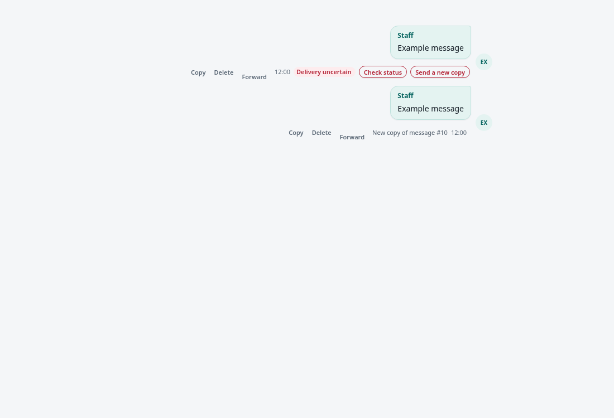
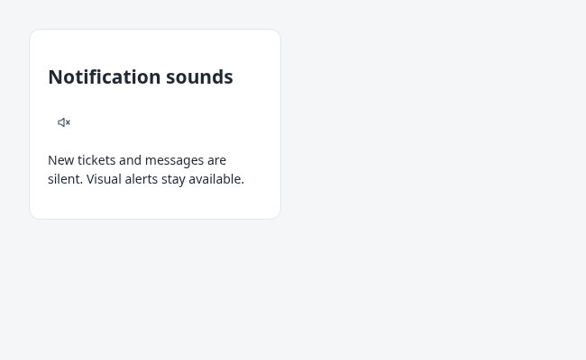

# Customer support: workflow, delivery, and maintenance

## Staff workflow and visibility

Open `/support` and sign in with a staff account. Claim an **Unassigned** ticket
before replying. **My tickets** contains assigned customer tickets; **Chats**
contains staff-started conversations. Resolve a ticket to end human handling.
Greetings and resolution messages are optional and empty by default. A staff
member can set their own messages in preferences.

The current visibility policy is unchanged by the hardening work:

| Action/data | Agent | Super Admin / Admin |
| --- | --- | --- |
| Read claimable, unassigned NEW tickets | Yes | Yes |
| Read own active tickets/chats | Yes | Yes |
| Read active conversations previously participated in | Yes, including Watching | Yes |
| Read unrelated active assigned conversations | No | Yes |
| List the global Active queue | No | Yes |
| Read resolved/closed customer ticket and chat history | Yes, shared across staff | Yes |
| Reply to an active conversation | Current assignee only | Current assignee only |
| Permanently delete resolved/closed ticket history | No | Yes |
| Edit or recall an eligible linked-device message | Original staff sender only | Original staff sender only |

**View shared history** shows earlier resolved/closed tickets and chats for the
same customer phone, including conversations handled by other staff or received
on another business number. History is paginated; it is not limited to the first
five conversations shown. Active conversations remain subject to access checks.
An original sender may receive updates to their own historical message after a
transfer without receiving the rest of an otherwise inaccessible conversation.
Deleting history from this app does not recall messages from WhatsApp.

Event streams use the authenticated staff session. Each incoming Redis event
and idle heartbeat revalidates the session against MariaDB, including expiry,
revocation, account activity, and current role. Ticket permissions are evaluated
for the current role. A failed validation ends the stream and closes the Redis
subscription; the browser's reconnect must authenticate again. Idle validation
normally happens within the 15-second heartbeat interval. Redis is an internal
notification bus, not a source of authorization. There is no durable SSE replay;
the dashboard's normal polling refreshes state after missed events.

## Reopening resolved customer tickets

The resolved ticket's **Reopen ticket** button is available to its last assignee
only when that same agent resolved it. Admins/Super Admins can reopen within their
existing visibility scope. These rules are checked again under the database
ticket lock; shared-history access does not grant reopening or sending rights.

The existing `current_assignee_id` remains the last assignee after resolution;
`resolved_by_staff_id` records the resolver. Missing legacy IDs never grant agent
permission. No migration or ownership backfill is needed. Regular agents retain
their assignment. As an explicit exception, an Admin/Super Admin who successfully
reopens a resolved ticket becomes its assignee, even when its previous assignee
is unknown or inactive. The new assignee must be active. Sending remains
assignee-only; the previous owner loses sending rights after reassignment.

Reopening restores the pre-resolution status recorded in new resolution audit
events. Older records without that status reopen as `ASSIGNED`. All messages,
resolution timestamps, resolver records, and audit events are retained. Each
successful transition adds a `TICKET_REOPENED` event with its actor, time, previous
assignee and resulting assignee. Repeated requests for the same resolution do not
add another event or change ownership again; concurrent reopeners cannot take
over a ticket after the first reopening succeeds. The API
requires the observed `resolved_at` value, including explicit `null` for legacy
records, to reject stale requests after a newer resolution cycle.

Only `RESOLVED` customer tickets qualify; staff chats retain their existing
workflow. Removed numbers, unavailable assignees, conflicting active conversations,
and active outbound attempts produce explicit conflicts. The existing unique
active-conversation key and delivery guard remain authoritative. Real-time
invalidation reloads queues, history, and permissions; the composer becomes
available only after backend confirmation. Redis mode is refreshed to human
support, with the durable database remaining authoritative if Redis is unavailable.

## Outbound delivery contract

The database is authoritative for staff text, location, media, and automatic
lifecycle messages. Browser `client_message_id` values are unique within
`(ticket_id, sender_type, sender_scope)`; `sender_scope` represents the staff ID
(or the empty system sender). A separate globally unique `transport_client_id`
correlates linked-device confirmations. The browser cannot use another ticket's
or staff member's key to fetch their message. Authorization runs before the
lookup; first payload wins within a scope. Do not reuse a key for a new message.

| Stored state | Meaning | Allowed recovery |
| --- | --- | --- |
| `PENDING` | Stored/preparing; no customer dispatch has begun | Resume unclaimed preparation, or reclaim an abandoned claim after five minutes |
| `DISPATCHING` | The dispatch marker was committed before provider I/O | Never resend; await confirmation or quarantine after five minutes |
| `SENT` | Provider accepted and its message ID was persisted, or an authenticated bridge confirmation reconciled it | No resend; delivery/read receipts are separate |
| `FAILED` with `delivery_retry_safe=1` | Preparation failed, or the provider definitively rejected dispatch | Sender may explicitly retry the same row while owning the conversation |
| `UNCERTAIN` | Provider acceptance cannot be ruled out | Check evidence; never retry this attempt. An authorized sender may explicitly create one tracked new copy after accepting duplicate risk. |

A database update atomically grants a random delivery token. Only that token can
cross the dispatch boundary and finish the attempt. A reclaimed worker is fenced
out. Concurrent retries compare the token of the observed attempt so they cannot
retry a newer failure. Ticket ownership is checked again at dispatch. Media
uploads happen before the dispatch marker because uploading an asset does not
send a customer message. Repeated upload after a preparation crash may leave an
unused provider asset; it does not duplicate the customer message.

### Ticket lifecycle and active delivery

Transfer, ticket resolution, and staff-chat closure use the same ticket-scoped
guard. A `PENDING` message with a current delivery claim blocks these operations
for its five-minute preparation lease, including media upload. Every
`DISPATCHING` message blocks them until completion or explicit recovery, even
after its lease expires. Message creation time is irrelevant: retrying an old
message obtains a fresh claim and blocks lifecycle changes again.

Claiming, beginning dispatch, and lifecycle changes acquire the parent ticket
lock before any message lock. If dispatch wins, the lifecycle transaction sees
the committed active state and refuses the change. If the lifecycle operation
wins, it marks unclaimed or expired preparation `FAILED` (safely not sent) and
replaces its token in the same transaction. A suspended worker cannot resume
that attempt, even if the chat is later reopened or transferred back. Resuming
requires an explicit retry with the newly observed token and the existing
sender/ownership permissions. No database lock spans upload or provider calls.

An expired preparation token cannot begin dispatch or record failure; reclamation
issues a different token. Recovery of an expired dispatch records `UNCERTAIN`,
never another send. `UNCERTAIN` does not block lifecycle changes and remains
visible in history; closure/transfer never relabels it. A matching late acceptance
may still mark it `SENT`, but a late failure cannot turn it into a retryable row.
Provider acceptance or a delayed in-flight request can arrive after recovery and
closure; this policy does not claim cancellation of work past the dispatch boundary.

Configured resolution notices remain separate system sends created after
resolution. Permissions and shared-history visibility are unchanged.

Duplicate send requests return the existing row/state without dispatching.
A duplicate does not automatically resume preparation. The UI offers **Resume
send** for pending preparation and **Resend** only for proven failures. A claim
still held by a live worker is left alone. Transport IDs and claim tokens are
not included in staff message responses.

### Transport differences and uncertainty

* **Cloud API:** one HTTP dispatch per owned attempt. Connection failures,
  HTTP 5xx, malformed success responses, and missing message IDs are uncertain.
  A normal HTTP 4xx rejection is treated as not accepted. There is no assumed
  Cloud API idempotency guarantee: a local client ID alone cannot stop Meta
  accepting a separately issued request. If acceptance was followed by a crash
  before the provider ID was saved, this app cannot automatically correlate a
  later Cloud receipt to that row.
* **Linked device:** the bridge serializes sends for a line and reserves its
  WhatsApp message ID durably before calling the socket. A duplicate transport
  key returns a confirmed result, or refuses another dispatch when the stored
  attempt is unconfirmed. Reusing the key for another recipient is rejected.
  A later WhatsApp acknowledgment/echo can reconcile the original dashboard row,
  including an uncertain one. Keep the bridge's durable data directory intact.
* These protections prevent concurrent application dispatches; they do **not**
  promise end-to-end exactly-once delivery. A crash immediately after the dispatch
  marker, even before any network bytes were sent, is conservatively uncertain.
  Creating a new browser key is a new send and bypasses deduplication by design.
* Edit/revoke operations retain their separate durable operation protocol.
  Reactions retain their existing reaction flow; this delivery-state machine
  covers persisted outbound timeline messages, not arbitrary bot/provider calls.

### Recovery procedure

When an API task is cancelled (for example during a service restart), it records
`FAILED` for preparation that has not dispatched, or `UNCERTAIN` after the
persisted dispatch boundary. This releases lifecycle blocking without resending.
Matching late acceptance can still confirm the message. Cancellation never
overwrites a confirmed result or a newer attempt. A hard process kill, repeated
cancellation, or unavailable database can prevent this cleanup; use the explicit
recovery command below after inspecting the abandoned worker.

1. Refresh the conversation and inspect the stored state. For `PENDING`, the
   original sender can choose **Resume send** while still assigned. Claims older
   than five minutes can be reclaimed; younger active claims cannot.
2. For `FAILED`, fix the reported preparation/configuration issue and choose
   **Resend**. Missing attachments must be restored before retrying; the server
   will not fabricate a replacement attachment.
3. After an outage, run `python scripts/recover_support_deliveries.py` in the
   app's configured environment. It marks dispatches older than five minutes
   `UNCERTAIN` and never contacts WhatsApp. This is an explicit operator command,
   not an automatic resend worker. Until recovery or confirmation, expired
   `DISPATCHING` rows continue to block transfer/resolution/closure. Inspect or
   stop abandoned workers before recovery; late confirmations remain valid.
4. For `UNCERTAIN`, use **Check status** or inspect the paired phone/provider
   evidence. Do not clear the marker, change its client ID, or force a SQL reset.
   The original attempt and its audit record are retained.

### Uncertain delivery actions



The API checks saved linked-device acknowledgements/own echoes in batches of 20,
with a 30-second pause between batches. A cursor ensures older unresolved rows
do not starve newer ones. Checks never contact a customer or resend a message.
Only matching confirmation changes a message to `SENT`; it does not fabricate
delivered/read receipts. The same check is available through **Check status**.
Cloud messages without a persisted provider ID cannot be reconciled this way;
absence of evidence never becomes a definitive failure. Bridge outages leave
the original state intact. Expired `DISPATCHING` rows are also checked for saved
confirmation, but this worker does not replace explicit abandoned-work recovery.

**Send a new copy** is available only to the current assignee of an active
conversation, with the existing sending permissions. It requires explicit
confirmation that the original might still arrive, and checks available evidence
again before inserting. Shared-history access allows status inspection, not
sending/reopening. Admins/supervisors must use the existing assignment workflow
when they do not own the conversation. There is no review queue.

A unique original-to-copy link permits only one replacement per uncertain
message, across simultaneous/repeated requests and staff changes. Repeated
requests return that same copy and never dispatch it again. The new row has its
own transport identity and records the sending staff member, timestamp, original
ID, and acceptance of duplicate risk in the ticket audit. The original remains
uncertain unless later evidence confirms it. A late arrival of both messages
is still possible. Copies use the usual delivery claims and failure recovery.
Text, location, and locally retained media are supported; missing attachments
are not silently replaced. The timeline labels the copy with the original ID.

Deploy `migrations/20261022_uncertain_delivery_copies.sql` before the new API.
It adds one nullable column and a unique index without changing existing rows.
Upgrade the bridge before starting the new API so the read-only lookup endpoint
is available. No new dependency or re-pairing is required. API startup verifies
both the column and uniqueness constraint. The migration may be left in place
when rolling back the application.

## Notification sounds



Use **Sound on / Sound muted** in the dashboard sidebar to toggle sounds for new
tickets and customer messages. The setting is saved in this browser and synced
across its open dashboard tabs; it applies to accounts using that browser.
Other browsers/devices keep their own setting. Sounds are on by default.
Visual alerts remain available, desktop notifications are requested silently
when muted, and voice-note playback is unaffected. If browser storage is blocked,
the toggle still works for the current page but may not persist after refresh.

## Local development and integration tests

For the persistent dev VPS, use the existing supervised API, bridge, Redis,
local MariaDB, and ingress described in [dev-deployment.md](dev-deployment.md).
Local interactive development can still use `uvicorn app.main:app --reload` with
private configuration and a local/private database. Do not use production
WhatsApp credentials or production databases for regression tests.

Install real Python and bridge dependencies:

```bash
python -m venv venv
venv/bin/python -m pip install -r requirements-dev.txt
npm ci --prefix whatsapp_bridge
```

Start disposable MariaDB 10.11 and Redis 7.4 on separate loopback ports:

```bash
docker compose -f deployment/test-services.compose.yml up -d --wait
```

Run unit and integration suites in **separate processes**. Some historical unit
modules install dependency doubles; the integration process imports the real
`aiomysql`, Redis, authentication, repository, service, and transport code. Each
integration test creates a uniquely named database, applies every SQL migration
in date order, checks the schema, and drops that database afterward. No shipping
business data is required. External HTTP is blocked except explicit mock
transports; no real WhatsApp messages are sent.

```bash
venv/bin/python -m pytest --ignore=tests/integration
SUPPORT_INTEGRATION=1 \
TEST_DB_HOST=127.0.0.1 TEST_DB_PORT=13306 \
TEST_DB_USER=root TEST_DB_PASSWORD=disposable-test-password \
TEST_REDIS_URL=redis://127.0.0.1:16379/15 \
venv/bin/python -m pytest tests/integration
npm test --prefix whatsapp_bridge
venv/bin/python -m compileall -q app scripts tests
venv/bin/python scripts/check_support_assets.py
git diff --check
docker compose -f deployment/test-services.compose.yml down -v
```

Native disposable servers are also supported: set `TEST_DB_SOCKET` instead of
host/port and use `TEST_REDIS_URL=unix:///path/to/redis.sock`. The MariaDB test user
needs permission to create/drop test databases. Never point these variables at
a shared development or production database server. Without
`SUPPORT_INTEGRATION=1`, integration tests explicitly skip; that is not a passing
integration run.

The voice-note DOM regression uses an installed Chrome/Chromium executable.
Set `SUPPORT_TEST_BROWSER=google-chrome` (or an absolute executable path) to
select it explicitly. An explicitly configured missing or failing browser fails
the test; local runs without an available browser skip this one check. CI uses
the Ubuntu runner's native Google Chrome and checks its version before testing.

GitHub Actions runs the same suites with MariaDB/Redis service containers and
real installed dependencies. It also runs the existing bridge tests, Python
compilation, JavaScript syntax checks (including the combined browser scope),
and whitespace checks. No pre-existing lint configuration was present; no
additional lint framework has been introduced.

## Code layout and release requirements

* `app/support_delivery.py`: provider-independent dispatch preparation/attempt.
* `app/support_delivery_repository.py`: database claims, fencing, and recovery.
* `app/support_repository.py`: conversation persistence and access-related queries.
* `app/support_auth.py`, `app/support_events.py`: live-session validation and SSE.
* `app/templates/support.html`: dashboard markup.
* `app/static/support/`: ordered classic scripts for state, events, dialogs, API,
  rendering, media, actions, plus theme/style assets. They deliberately retain
  the existing shared browser scope; this is not a framework/module migration.
* `app/support_ui.py`: route/configuration adapter and asset allowlist. All asset
  contents contribute to the deploy-version hash. The existing image-editor
  route is preserved. Ship templates and static files with Python source; there
  is no separate build step. The assembled `_HTML` source view exists for existing
  DOM regression tools and is not the production response.

### Upgrade to outbound ownership

1. Stage and test a complete release, including templates, static assets, and
   bridge changes. Keep bridge session/media state outside the release.
2. Stop API and bridge workers to drain/quiesce outbound work. Back up the
   database/schema and retain the prior release and bridge state.
3. Apply **only the new migration** to an existing fully migrated installation:
   `migrations/20261021_outbound_delivery_ownership.sql`. It needs `ALTER`, `INDEX`,
   and `UPDATE` permissions. It adds ownership/correlation columns, replaces the
   global browser-key unique index with a scoped unique index, and adds a unique
   transport index. Existing pending/failed attempts without delivery evidence
   are conservatively quarantined. Historical message content is retained.
4. Run `python scripts/check_runtime.py --schema` with the staged release's
   environment. Startup checks both required columns and unique index shapes;
   a partially applied migration must not start serving sends.
5. Switch the release symlink, start bridge/API, check readiness and `/health`,
   and load `/support` plus its versioned assets. Run the recovery command after
   an outage. Never run a duplicate bridge using the same saved sessions.

The migration is repeatable, but do not replay all historical data migrations on
an existing server: the greeting/reset migration intentionally clears preferences.
The new database contract is **not compatible with pre-hardening send code**.
A code-only rollback to that code would reintroduce unsafe global client-ID
lookups and resend behavior. Prefer a forward fix or a compatible hardened
release; an older-code rollback needs a planned database restore while writes
are stopped, with explicit handling of any messages accepted since the backup.

## Linked-device callback recovery

“Updates pending” counts bridge-to-app callbacks that still need delivery, including receipts;
these are not necessarily unsent staff messages. A connected WhatsApp socket does
not by itself confirm that every callback has reached the database. Each line now
has its own callback worker, so a slow office line does not stall other lines.
Retries remain durable and idempotent; permanent HTTP failures remain visible as
failed updates rather than being silently discarded.

Shared contact cards display their names, phone numbers, and available email/company
details in the conversation. Single contacts and contact bundles work for linked
devices and Cloud API inbound messages. Stored linked-device contact markers are
upgraded automatically without duplicating messages or restoring deleted content.
Other content the dashboard cannot render is saved as a visible **unsupported
WhatsApp message** marker; its content remains available in WhatsApp. Album envelopes, encryption controls and
incomplete placeholders are not presented as standalone customer messages.
Previously stored, unnotified unsupported content is recovered automatically:
it is attached to the historical conversation when its timestamp matches, otherwise
the active conversation or a new unassigned ticket. Recovery does not call AI,
notify customers, or reopen resolved tickets. Deleted content stays deleted.

Phone responses to unavailable-message recovery requests are accepted only when
matched to a previously observed placeholder's ID, chat, sender direction and,
when known, request ID. Original routing and timestamps are retained. This fixes
the old blanket rejection of recovery payloads; it cannot reconstruct messages
that WhatsApp never delivered or that an older bridge discarded without storing.
Reactions whose target is absent retry for up to 24 hours to allow target recovery,
then are acknowledged as outside the support transcript. Actual message content
is not expired by this reaction-only rule.

An explicit API response distinguishes reactions waiting for an absent history
target from message-delivery failures. The bridge retains these reactions in its
durable outbox and retries normally, including after restarts, but reports them
separately as `waiting_history_reactions`. Hover over the connection status to
see this background count. They do not inflate “updates pending”. Network,
database, media, and authentication failures remain pending/failed updates;
only the validated missing-reaction-target response enables this distinction.
If the target arrives, the reaction is applied before expiry is considered.

Deploy the API before the bridge: older APIs do not recognize `message_snapshot`
callbacks. No SQL migration or re-pairing is required. Keep the API upgrade when
rolling back only the bridge, so already queued snapshots remain deliverable.


## Staff-authored text

Staff-authored message bodies and captions retain their entered text, including
explicit passwords, in delivery, chat history, reply previews, copying, and search.
The first message of a staff-started chat follows the same rule. This also applies
to staff messages mirrored from the linked phone. Authorization and deletion rules
are unchanged. Authentication input, diagnostic context, and error details retain
their existing redaction. Previously persisted `[REDACTED]` values cannot be
reconstructed; staff must edit or resend those intentionally if needed.

Contact details are stored as bounded, searchable text under message type
`contacts`; no database migration is needed. Replayed cards upgrade only existing
unsupported markers with the same provider ID. Deploy the API before the bridge
so new contact callbacks can be accepted. This adds display for shared cards, not
a new contact-sharing composer.

## Agent Statistics

Admins and supervisors open **Statistics** in the dashboard header. The reporting
API (`GET /api/support/statistics`) checks the current authenticated role on every
request; regular agents cannot retrieve either individual or team reports. All
staff can submit a CSRF-protected heartbeat for their own session only. Existing
conversation permissions are unchanged. Reports use the application's existing
local MariaDB pool, with no separate database connection or remote catalog query.

Choose inclusive calendar dates (up to 366 days), a staff member or **All staff**,
and a ranking metric/order. Dates use the browser's timezone, shown above the
leaderboard; the API defaults to Asia/Beirut. Daylight-saving boundaries are
converted to UTC. Equal values share a rank; name and ID make ties stable. Totals
sum the displayed staff rows, including inactive accounts retained in the database.

| Metric | Attribution and counting |
| --- | --- |
| Tickets claimed | Distinct tickets with `TICKET_CLAIMED` audit events performed by that staff member in the selected range. Transfers and reopenings are not claims. |
| Tickets resolved | Distinct tickets with staff `TICKET_RESOLVED` audit events in the range. Repeated resolutions of the same ticket count once per staff member in that range; automatic system resolutions do not count. |
| Outbound messages sent | Confirmed `SENT` outbound `AGENT` message rows with a provider ID and identifiable staff sender, across tickets and chats. Includes media and later recalled messages. Excludes AI/system notices, pending/failed/uncertain sends and phone-app replies with no staff identity. Uses delivery-attempt time when recorded; legacy rows fall back to creation time. Edits and receipts do not move that timestamp. |
| Active dashboard time | Union of confirmed activity intervals for that staff member, across all tabs and login sessions. No historical activity is inferred. |

Ticket and message counts use retained audit/message records, never the current
assignee. A ticket handled by multiple people can contribute to multiple staff
rows; team totals intentionally sum those rows. Permanently deleting conversation
history also removes its historical counts. The report shows the earliest retained
ticket/message records and the exact active-time tracking start date. Coverage
dates indicate available records, not a guarantee of complete past history.

### Activity accounting

A visible, focused dashboard sends a heartbeat every 15 seconds while active.
Pointer, keyboard, wheel and touch activity renew a 60-second inactivity timeout.
Idle/hidden/unfocused dashboards stop active heartbeats. Resuming creates a new
baseline. The server credits only the interval between accepted heartbeats, capped
at the preceding activity deadline; gaps longer than 45 seconds earn no time.
It does not credit future time if a browser crashes or loses its connection.
Offline time and a final unconfirmed interval may therefore be undercounted.
This is an activity estimate, not a tamper-proof attendance or productivity measure.

A short transaction locks the staff row, rechecks the session, ignores stale or
repeated sequence numbers, and merges overlapping intervals into a daily UTC
union. This prevents duplicate time across tabs/sessions without holding locks
across network calls. Heartbeat baselines older than two days are cleaned up on
subsequent activity. Reports are loaded on demand, not continuously polled.

### Installation and verification

Apply `migrations/20261023_agent_statistics.sql` on the **local application database**
before deploying the code. It adds three small tracking tables, two reporting
indexes and an indexed generated send-time column. It is safe to reapply and
preserves the first tracking-start timestamp. Adding the stored column/indexes
may rebuild existing tables: schedule a quiet deployment for a large database.
Grant the runtime account SELECT/INSERT/UPDATE/DELETE on the three new tables if
it uses per-table grants. No remote database changes or new secrets are required.
Older code can run with this additive schema; rollback need not remove history.

Run `venv/bin/python -m pytest tests/test_agent_statistics.py` for date/UI tests.
With the disposable MariaDB/Redis environment described above, run
`venv/bin/python -m pytest tests/integration/test_agent_statistics.py` separately
for real-session authorization, actor/range accuracy, rankings, idle recovery and
concurrent overlapping heartbeats. CI includes both through the existing suites.

## Dropped/pasted attachments and PDF quick replies

Drop one supported file onto the chatbox, or paste a copied image into its message
field. The attachment appears in the existing preview; add a caption if wanted,
then click **Send**. Nothing sends automatically. Ordinary text paste still works.
The picker, drop and paste paths accept JPEG/PNG images, WebP stickers, MP4/3GP
videos and PDFs, using the configured media size limits. Unsupported/empty files,
multiple-file drops, read-only conversations, message editing and active voice
recordings are rejected. Dropping over an existing attachment does not replace it.

In **Quick replies → New reply**, choose an optional **PDF file**. A saved PDF can
have a title and a caption (up to 1024 characters); its caption may be empty.
Select **Attach PDF** to load it into the current writable conversation, review
the preview, then send normally. Send or clear an existing draft first. Text-only
quick replies continue to copy their message. Search also matches PDF filenames.
Edit to change the title/caption or replace the PDF; Delete removes the saved
reply and its private file. Already-sent conversation attachments are independent.
All saved replies remain private to their owner, including against admins and
supervisors. Each PDF counts toward the existing 200-reply limit per staff member.

Apply `migrations/20261023_quick_reply_pdfs.sql` to the local application database
before deploying. It adds three nullable metadata columns to `support_quick_replies`
and is safe to reapply. Existing text replies remain intact; no new grants or
credentials are required. PDFs are stored under `SUPPORT_MEDIA_DIRECTORY/quick-replies`
with opaque filenames and served only through authenticated, owner-scoped endpoints.
Back up this directory together with the local database. Keep it outside the public
web root. PDF uploads check their signature and configured size limit; this is not
an antivirus scan. Unknown database commit outcomes retain the file to avoid deleting
a successfully saved PDF. Such failures/crashes can leave unreferenced files: during
maintenance with uploads stopped, compare filenames against `attachment_key` before
removing unreferenced files; never remove referenced files by age alone. Refresh the
quick-reply list after a failed save before saving another copy.

The ticket action and confirmation button now say **Resolve**. Resolution behavior
(including returning the customer to AI) is unchanged.

### Permanent staff deletion and statistics exports

The dashboard calls the stored `supervisor` role **Super Admin**. This is a display
name change; API role identifiers, existing sessions and permissions stay the same.
Admins and Super Admins can delete other accounts; self-deletion remains forbidden.
Deletion now removes the `staff` row, sessions, private quick replies (including
saved PDFs), activity intervals/heartbeats and personal message-hide records in one
database transaction. PDF files are removed after commit. If filesystem cleanup
fails or the process stops after commit, an inaccessible orphan PDF may remain;
check the server log and remove unreferenced files during maintenance.

Conversation messages, ticket assignments and actor audit records are preserved.
The resolver foreign key becomes NULL; resolution events retain their original
actor. Transfer active work before deleting its assignee. If already deleted, an
Admin/Super Admin can find that work in **Active** and use the existing transfer
workflow. Deletion does not cancel or retry in-progress/uncertain deliveries.
Old soft-deleted accounts are excluded from statistics as well; this release does
not bulk-delete legacy tombstones. Inactive, non-deleted accounts remain reportable.
Deleted staff and their counts are excluded from leaderboard filters and totals.

In **Statistics**, apply dates, staff and ranking, then choose **Download PDF**.
The export re-queries the local database using the last successfully applied filters
and current authorization; newly recorded actions may change its totals. It includes
ranking direction, timezone, selected-staff totals and historical coverage notes.
GET `/api/support/statistics/pdf` accepts the same query parameters and enforces the
same Admin/Super Admin permission as the report API; responses are private/no-store.
PDFs are generated in memory, with pagination and an embedded licensed DejaVu font
for Latin/Arabic names. Install updated `requirements.txt` before restarting the API.
No database migration is required. Existing downloaded files cannot be revoked.

### Staff name changes

Staff IDs remain the identity and permission source. Ticket/chat assignment and
initiator labels, staff message/reaction names, reply quotes, search results and
timeline actor labels resolve the current staff name when read. Statistics,
transfer choices and account identity use the same account record. AI settings'
last-saved-by label also resolves the current name on refresh.

Renaming publishes a name-only `staff_profile_updated` event after the database
commit; authenticated dashboards update cached labels, their own identity and an
open statistics report. The editing dashboard also updates from the successful
save response. Read-time resolution repairs existing stale labels without a
migration and prevents an older in-flight request from restoring an old displayed
name. No conversation ownership, permissions, delivery state or message body is
changed. Persisted names and audit details remain historical snapshots; if a staff
account has been deleted, those saved names remain the fallback. Customer names
and replies sent directly from WhatsApp are not relabeled as staff.

### Transfer statistics

Statistics and PDF exports include **Tickets transferred** and **Tickets received
by transfer**, with date/staff filters, totals and ranking in either direction.
Both count distinct ticket IDs per staff member within the selected dates; a
repeated transfer of the same ticket does not inflate that person's metric.
Staff chats are included, matching the shared ticket lifecycle audit.

Transferred is attributed to `TICKET_TRANSFERRED.actor_id` (the staff member who
performed the action), even when an Admin/Super Admin transfers someone else's
work. Received uses the event's `details_json.to_agent_id`, never the ticket's
current assignee. Missing/invalid recipient details are excluded from received
counts without losing an identifiable actor's outgoing credit. Deleted staff are
excluded from rows/totals, but their transfers can still count for an existing
recipient. Inactive accounts remain reportable. Consequently totals need not match.

These metrics use retained historical events in the local database; the report
shows when retained transfer audit starts. No migration, new tracking table or
remote database connection is required. Admin/Super Admin access is unchanged.
